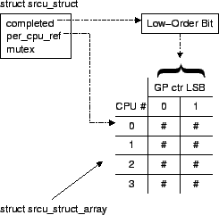
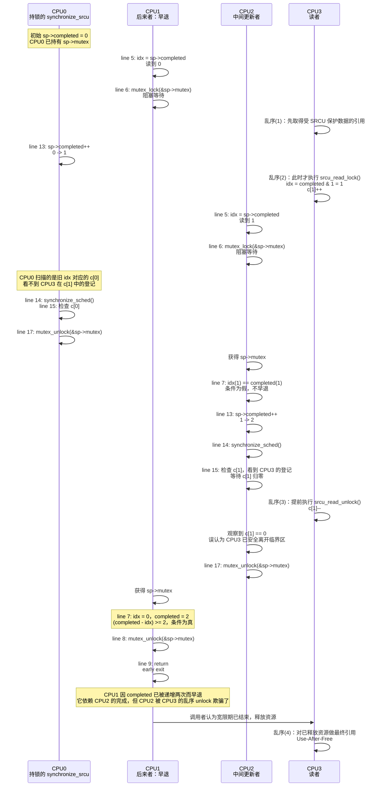

# Sleepable RCU
October 9, 2006 This article was contributed by Paul McKenney

经典 RCU 要求读端临界区遵守和纯自旋锁临界区一样的规则：**严禁任何形式的阻塞或睡眠**。
这一点常常成为 RCU 落地使用的阻碍，我收到过大量需求，希望有一种“可睡眠 RCU”（SRCU），允许在 RCU 读端临界区内任意睡眠（阻塞）。
我之前一直拒绝这类需求，认为它不可行：如果 RCU 读端可以无限制睡眠，宽限期就会被无限拉长（indefinitely extend），进而导致大量内存中的对象一直等待宽限期结束，最终会因内存耗尽造成系统挂死。
说到底，任何并发控制原语，就算使用方式完全正确，依然有可能引发系统挂死的话，它就不该存在。

但是，实时内核不仅要求自旋锁临界区支持抢占[3]，也要求 RCU 读端临界区可抢占[2]。
可抢占临界区又要求锁获取原语能够阻塞，以此避免死锁；这也就意味着 RCU 和自旋锁的临界区都需要可以阻塞、等待锁。
不过这一类睡眠有一个特点：可以通过优先级提升、优先级继承机制快速唤醒睡眠的任务。

即便如此，实时内核中对 RCU 的使用，第一次打破了“RCU 读端临界区绝对不能睡眠”这条铁律。但要说明：即便是实时内核，**无限期睡眠**（比如阻塞等待 TCP 连接到来）依然是严格禁止（verboten，原文借用德语）的。

**快速自测题 1**：为什么经典 RCU 的读端临界区内禁止睡眠？

**快速自测题 2**：能不能把上下文切换从静默状态里剔除，只保留用户态执行、空闲循环作为静默状态，以此允许经典 RCU 读端临界区内睡眠？

## SRCU 实现思路
设计 SRCU 面临的核心难题：不能让某个任务在 RCU 读端临界区内睡眠时，阻塞数量无上限的 RCU 回调。
SRCU 依靠两项策略达成该目标：
- 不提供异步宽限期接口，例如经典 RCU 里的 `call_rcu()`；
- 每个使用 SRCU 的子系统，独立做宽限期检测。

下面小节会解释这两项策略背后的理由。

### 取消（Abolish）异步宽限期 API
`call_rcu()` 的问题在于：单个线程可以源源不断分配内存块、注册回调，等待宽限期完成，内存等待数量没有上限，示例如下：
```c
while (p = kmalloc(sizeof(*p), GFP_ATOMIC))
    call_rcu(&p->rcu, f);
```

与之对比，使用 `synchronize_rcu()` 的等价写法，每个线程同一时间最多只有一块内存在等待宽限期：
```c
while (p = kmalloc(sizeof(*p), GFP_ATOMIC)) {
    synchronize_rcu();
    kfree(&p->rcu, f);
}
```

因此 SRCU 只提供和 `synchronize_rcu()` 对等的同步接口，不提供 `call_rcu()` 这类异步接口。

### 宽限期检测相互隔离
经典 RCU 中，一段读端临界区就可以拖慢 **全部** RCU 回调，示例如下：
```c
/* 有 BUG：切勿使用！！！ */
rcu_read_lock();
schedule_timeout_interruptible(longdelay);
rcu_read_unlock();
```

如果 RCU 只在一个子系统内部使用，并且该子系统做好设计，能够承受宽限期长时间延迟，这种行为或许尚可接受。
但问题在于：**一个独立子系统里一处 RCU 读端 bug，会拖累所有使用 RCU 的模块**，这也是必须杜绝（abolish）这种长时间读端延迟的原因。

**解决该问题的办法**：按子系统独立做宽限期检测。这样一个慢的（lethargic）RCU 读者，只会拖慢它所在子系统内的宽限期，不会影响其他子系统。
每个子系统中等待宽限期的内存块数量是有界的，同时子系统总数本身（presumably）也有限，因此全局等待宽限期的总内存量就能被控制住。
子系统开发者需要负责两点：
1. 保证 SRCU 读端里的睡眠时长是有界的；
2. 控制等待 `synchronize_srcu()` 的内存总量。[1]

SRCU 正是采用这套方案，下一节会继续说明。

## SRCU API 与使用方式
SRCU 的 API 如下，后续小节介绍其用法：
```c
int init_srcu_struct(struct srcu_struct *sp);
void cleanup_srcu_struct(struct srcu_struct *sp);
int srcu_read_lock(struct srcu_struct *sp);
void srcu_read_unlock(struct srcu_struct *sp, int idx);
void synchronize_srcu(struct srcu_struct *sp);
long srcu_batches_completed(struct srcu_struct *sp);
```

### 初始化与清理
每个使用 SRCU 的子系统都需要创建一个 `struct srcu_struct`，可以直接定义该类型变量，也可以动态分配内存（例如通过 `kmalloc()`）。
该结构体就绪后，必须调用 `init_srcu_struct()` 完成初始化；返回值为 `0` 代表成功，非 `0` 是错误码（比如内存耗尽）。

如果 `struct srcu_struct` 是动态分配得来的，释放这块内存之前必须调用 `cleanup_srcu_struct()`。
同理，如果它是内核模块内定义的局部变量，模块卸载前也要调用该清理函数。
无论哪种场景，调用 `cleanup_srcu_struct()` 之前，调用者必须保证：**所有 SRCU 读端临界区都已经结束，并且不会再有新的读临界区启动**。
下文会给出实现该保证的一种方法。

### 读端原语
读端接口 `srcu_read_lock()` 和 `srcu_read_unlock()` 的使用示例：
```c
idx = srcu_read_lock(&ss);
/* 读端临界区 */
srcu_read_unlock(&ss, idx);
```
`ss` 就是前面初始化好的 `struct srcu_struct`；
`idx` 是整型返回值，它本质上告诉 `srcu_read_unlock()`：对应的 `srcu_read_lock()` 是在哪一个宽限期内启动的。

这种需要传递索引的设计，和经典 RCU 不同。经典 RCU 会把相关信息存放在任务结构体里。
但同一个任务可能存在大量嵌套的 SRCU 读临界区，因此 SRCU 不适合把索引保存在任务结构体中。

### 更新端原语
`synchronize_srcu()` 使用示例：
```c
list_del_rcu(p);
synchronize_srcu(&ss);
kfree(p);
```
类比经典 RCU 很好理解：该原语会阻塞，等待 **所有在 `synchronize_srcu()` 调用之前启动的 SRCU 读临界区全部执行完毕**（如 Table 1 所示）。

Table 1: SRCU 更新和读侧临界区

. | CPU 0                    | CPU 1                          | CPU 2                    | CPU 3
--|--------------------------|--------------------------------|--------------------------|-----------------------
1 | i0=srcu_read_lock(&s1);  |                                |                          | i3=srcu_read_lock(&s2);
2 |                          | synchronize_srcu(&s1); [enter] |                          |
3 |                          |                                | i2=srcu_read_lock(&s1);  |
4 | srcu_read_unlock(&s1,i0);|                                |                          |
5 |                          | synchronize_srcu(&s1); [exit]  |                          |
6 |                          |                                | srcu_read_unlock(&s1,i2);|

举个例子：CPU1 只需要等待 CPU0 的 SRCU 读临界区结束，不需要等待 CPU2 的读临界区 —— 因为 CPU2 的读临界区是在 CPU1 开始执行 `synchronize_srcu()` *之后* 才启动的。
CPU1 也不需要等待 CPU3 的 SRCU 读临界区，因为 CPU3 使用的是另一个 `srcu_struct`（`s2`），而不是 `s1`，它的宽限期和 CPU0、CPU2 互相独立。

译注：第三行 CPU2 列的原来写的是 `i3=srcu_read_lock(&s1);` 疑似错误，应该是 `i2`

`srcu_batches_completed()` 用来查看某个 `struct srcu_struct` 的宽限期推进进度。
这个接口主要用于 SRCU 功能验证的压力测试（torture tests）。

## 安全清理
安全地清理 SRCU 有一定难度，不过好在很多场景并不需要清理。
例如，系统内核中在启动阶段就完成初始化的用法，无需清理。但如果用法位于可加载模块中，要安全卸载该模块，就必须做清理。

某些场景下（例如 RCU torture 折磨测试模块），只有一小批已知的线程会针对某个特定 `struct srcu_struct` 使用 SRCU 读端原语。
这种情况下，模块退出代码只需终止这批线程、等待它们退出，然后再执行清理即可。

但在另一些场景（例如设备驱动），系统中 **任意** 线程都可能在使用 SRCU 读端原语。此时虽然也可以套用上一段所述做法，但效果基本等同于整机重启，这显然不太理想。
下面的示例给出了一种无需重启就能完成清理的思路：

```c
 1  int readside(void) {
 2      int idx;
 3      rcu_read_lock();
 4      if (nomoresrcu) {
 5          rcu_read_unlock();
 6          return -EINVAL;
 7      }
 8      idx = srcu_read_lock(&ss);
 9      rcu_read_unlock();
10      /* SRCU 读端临界区 */
11      srcu_read_unlock(&ss, idx);
12      return 0;
13  }
14
15 void cleanup(void)
16 {
17     nomoresrcu = 1;
18     synchronize_rcu();
19     synchronize_srcu(&ss);
20     cleanup_srcu_struct(&ss);
21 }
```

`readside()` 函数让一段 RCU 读端临界区和一段 SRCU 读端临界区相互嵌套：前者覆盖第 3–9 行，后者覆盖第 8–11 行。
其中 RCU 读端临界区采用“纯 RCU”方式来保护 `nomoresrcu` 变量的取值。如果该变量已被置位，说明系统正在清理，此时不能进入 SRCU 读端临界区，于是返回 `-EINVAL`；反之若尚未开始清理，就继续进入 SRCU 读端临界区。

`cleanup()` 函数先在第 17 行把 `nomoresrcu` 置位，然后通过第 18 行的 `synchronize_rcu()` 原语，等待所有正在执行的 RCU 读端临界区结束。
一旦 `cleanup()` 执行到第 19 行，所有可能看到 `nomoresrcu == 0` 的 `readside()` 调用，必然都已经执行到第 8 行，也就必然已经进入了各自的 SRCU 读端临界区；其余调用则会从第 6 行直接返回，不会再进入读端临界区。

因此，当 `cleanup()` 在第 19 行完成 `synchronize_srcu()` 调用时，所有 SRCU 读端临界区都已经结束，并且不会再有新的读端临界区启动。于是第 20 行调用 `cleanup_srcu_struct()` 就是安全的了。

> 原文勘误说明：原文称“via the synchronize_rcu() primitive on line 19”，但按上面代码 `synchronize_rcu()` 实际位于第 18 行（第 19 行是 `synchronize_srcu()`），后续“Once cleanup() reaches line 19”也沿用了同一编号；另原文有一处 `nomorersrcu` 拼写错误，应为 `nomoresrcu`。

## 实现
本节介绍 SRCU 的数据结构、初始化与清理原语、读端原语以及更新端原语。

### 数据结构
下文给出了 SRCU 数据结构的源码形式与示意图。

`completed` 字段用于记录自 `srcu` 结构体 **初始化以来已经完成的宽限期数量**；如图所示，它的最低位用来索引 `srcu_struct_array` 结构体。

`per_cpu_ref` 字段指向该数组，`mutex` 字段用于保证同一时刻只能有一个 `synchronize_srcu()` 执行。



```c
1 struct srcu_struct_array {
2     int c[2];
3 };

4 struct srcu_struct {
5     int completed;
6     struct srcu_struct_array *per_cpu_ref;
7     struct mutex mutex;
8 };
```

译注：
* 写端更新完后会调用 `synchronize_srcu()` 等待对应代际的 SRCU 的读端都退出临界区，期间会 `srcu_struct.completed++` 表示完成了更新换代
* `srcu_struct_array.c[2]` 两个槽位分别用来交替追踪 `srcu_struct.completed++` 前后的新老读者的计数
  * `srcu_struct.completed++` 前采样的老读者用了一个槽位，`srcu_struct.completed++` 后采样的新读者则会用另一个槽位
* 由于只有 **两个** 槽位，当写者 `synchronize_srcu()` 发现自己的代际 `srcu_struct.completed` 的快照 `idx` 落后于最新的代际 **大于两个** 时（`(sp->completed - idx) >= 2`），说明它持有的拷贝不是最新的且没有对应读者了，因此拿到锁 `mutex` 后可以直接返回，走到后面的回收阶段
* 由于读端可能发生在某个 CPU 上，所以 `struct srcu_struct_array` 实例需要是 per-CPU 的

### 初始化实现
SRCU 的初始化函数 `init_srcu_struct()` 如下。该函数仅对 `srcu_struct` 的各个成员做初始化，初始化成功返回 `0`，失败（内存不足）返回 `-ENOMEM`。
```c
1 int init_srcu_struct(struct srcu_struct *sp)
2 {
3     sp->completed = 0;
4     mutex_init(&sp->mutex);
5     sp->per_cpu_ref =
6         alloc_percpu(struct srcu_struct_array);
7     return (sp->per_cpu_ref ? 0 : -ENOMEM);
8 }
```

SRCU 的清理相关函数如下：
```c
 1  int srcu_readers_active_idx(struct srcu_struct *sp,
 2          int idx)
 3  {
 4      int cpu;
 5      int sum;
 6
 7      sum = 0;
 8      for_each_possible_cpu(cpu)
 9          sum += per_cpu_ptr(sp->per_cpu_ref, cpu)->c[idx];
10      return sum;
11 }
12
13 int srcu_readers_active(struct srcu_struct *sp)
14 {
15     return srcu_readers_active_idx(sp, 0) +
16             srcu_readers_active_idx(sp, 1);
17 }
18
19 void cleanup_srcu_struct(struct srcu_struct *sp)
20 {
21     int sum;
22
23     sum = srcu_readers_active(sp);
24     WARN_ON(sum);
25     if (sum != 0)
26         return;
27     free_percpu(sp->per_cpu_ref);
28     sp->per_cpu_ref = NULL;
29 }
```

核心清理函数 `cleanup_srcu_struct()` 位于第 19–29 行，它会先调用第 13–17 行的 `srcu_readers_active()`，确认当前没有读者正在使用这个 `srcu_struct`。

`srcu_readers_active()` 会把两个索引上调用 `srcu_readers_active_idx()` 的结果相加；而 `srcu_readers_active_idx()`（第 1–11 行）会遍历所有 CPU，累加指定索引对应的 per-CPU 计数器，返回总和。

如果 `srcu_readers_active()` 返回值非 0，说明还有活跃读者，`cleanup_srcu_struct()` 在第 24 行触发告警，然后在 25、26 行直接返回，不会销毁仍在使用的 `srcu_struct`。
这类告警一定代表代码存在 bug；既然 bug 已经上报，相比引发内存损坏，宁可让系统带着少量内存泄漏继续运行。

如果返回值为 `0`，`cleanup_srcu_struct()` 在第 27、28 行释放 per-CPU 计数器数组，并将指针置空。

### 读端实现
`srcu_read_lock()` 的实现代码如下：
```c
 1  int srcu_read_lock(struct srcu_struct *sp)
 2  {
 3      int idx;
 4
 5      preempt_disable();
 6      idx = sp->completed & 0x1;
 7      barrier();
 8      per_cpu_ptr(sp->per_cpu_ref,
 9      smp_processor_id())->c[idx]++;
10      srcu_barrier(); //内核 SRCU 论文里的 srcu_barrier() 宏：!CONFIG_PREEMPT=y → barrier()；CONFIG_PREEMPT=y → 空操作。
11      preempt_enable();
12      return idx;
13 }
```
该函数经过精心设计，**不需要内存屏障与原子指令**。

第 5 行、第 11 行分别关闭、开启抢占，保证这段代码在同一个 CPU 上执行期间不会被抢占。

第 6 行取出宽限期计数器的最低位，用它来选择本次 SRCU 读端临界区要使用哪一组 per-CPU 计数器。

第 7 行的 `barrier()` 是给编译器的指令，保证索引只读取一次，从而让第 9 行使用的索引和第 12 行返回的索引保持一致。

> 译注：如果没有第 7 行的 `barrier()` 编译器有可能会把第 12 行优化成 `return sp->completed & 1`，但是其他 CPU 有可能会在这期间修改 `sp->completed`。而 `barrier()` 阻止编译器把 `sp->completed` 的读取推迟到屏障之后，强制只采样一次 `completed`，保证 *给计数器自增用的下标* 和 *返回给 read_unlock 的下标* 是同一个快照，不会因为编译器消除临时变量、重复 load 而出现两个不同 `idx`。

第 8–9 行对当前 CPU 上选中的计数器做自增。

第 10 行保证后续代码在 8–9 行执行完成之后才运行，目的是在非抢占内核（`CONFIG_PREEMPT=n`）下，防止中断视角下的指令乱序；但在 **开启抢占** 的内核里，`preempt_enable()`（第 11 行）内部已经自带屏障，此时 `srcu_barrier()` 是 **空操作**。

> 译注：`srcu_barrier()` 在非抢占内核下作为一个编译器屏障，专门防止编译器将计数器自增操作“延迟”到 `return` 之后。这确保了在机器指令层面，计数器的更新先于返回发生。从而保证任何异步介入的中断处理程序，都能观察到读者已经“登记”在案的正确状态，而不是一个可能被编译器优化掉的安全窗口。否则，如果一个中断在“返回”和“计数”这两条机器指令之间介入，中断处理程序可能看到的将是一个“计数器尚未自增”的过时状态。这会破坏 SRCU 的核心约定：读者在进入临界区前，必须让更新者“看到”自己的存在。

最后第 12 行返回索引，这个索引要传给配对的 `srcu_read_unlock()`。

`srcu_read_unlock()` 的代码如下：
```c
 1 void srcu_read_unlock(struct srcu_struct *sp, int idx)
 2 {
 3     preempt_disable();
 4     srcu_barrier();
 5     per_cpu_ptr(sp->per_cpu_ref,
 6                 smp_processor_id())->c[idx]--;
 7     preempt_enable();
 8 }
```
同样，第 3、7 行关闭并重新开启抢占，保证整段代码在同一个 CPU 上原子执行、不会被抢占。

开启抢占的内核中，第 3 行的 `preempt_disable()` 内部已经包含屏障；非抢占内核则由第 4 行的屏障提供。
该屏障同样是从中断处理程序的视角，保证后续代码在临界区操作之后执行。

> 译注：`srcu_barrier()` 是防止读端临界区里，用户还在访问受 SRCU 保护的共享数据；但是 `c[idx]--` 这个 store，被编译器重排，**提前到 SRCU 临界区的代码之前对外可见**。这里的关键：**`c [idx]--` 和用户临界区数据访问之间，没有地址依赖**，用户临界区访问数据 `obj`，`c[idx]--` 是独立计数器，二者没有值依赖、没有地址依赖。没有依赖，编译器就可以重排。

第 5–6 行，使用和对应 `srcu_read_lock()` 相同的索引，对当前 CPU 的计数器做自减。

**核心要点**：其他 CPU 想要读取某个 CPU 的计数器，只能借助该 CPU 自身的中断处理程序配合完成。
由中断处理程序负责：在读取计数器之前，执行必要的内存屏障。

### 更新端实现
SRCU 的核心原理：`synchronize_sched()` 会阻塞，直到所有正在执行的、关闭抢占的代码段全部执行完毕。

`synchronize_srcu()` 原语大量利用该特性，实现如下：
```c
 1  void synchronize_srcu(struct srcu_struct *sp)
 2  {
 3      int idx;
 4
 5      idx = sp->completed;
 6      mutex_lock(&sp->mutex);
 7      if ((sp->completed - idx) >= 2) {
 8          mutex_unlock(&sp->mutex);
 9          return;
10      }
11      synchronize_sched(); //等待看到旧 completed 的读端 srcu_read_lock() 采样完成，确保读者能看到前面的修改
12      idx = sp->completed & 0x1;
13      sp->completed++;     //更新换代
14      synchronize_sched(); //等待看到新 completed 的读端 srcu_read_lock() 采样完成，保证后面轮询 idx 的计数器只会单调递减
15      while (srcu_readers_active_idx(sp, idx))
16          schedule_timeout_interruptible(1);
17      synchronize_sched(); //等待读端 srcu_read_unlock() 执行完毕
18      mutex_unlock(&sp->mutex);
19 }
```

第 5 行对宽限期计数器做一次快照。

第 6 行获取互斥锁；

第 7–10 行检查：自快照之后是否已经至少完成两个宽限期。如果是，说明其他线程已经帮我们完成了等待工作，直接释放锁并返回。

如果不满足，执行第 11 行：`synchronize_sched()` 保证：其他 CPU 一旦在 `srcu_read_lock()` 里读到递增后的宽限期计数器，就一定能看到当前 CPU 在进入 `synchronize_srcu()` 之前所做的修改。
我们需要这个（`synchronize_sched()` 带来的）保证，来确保：那些不会阻塞本轮宽限期的 SRCU 读端临界区（也就是版本切换之后才启动的新读者），一定能看到本次 `synchronize_srcu()` 调用之前完成的所有更新。

第 12 行取出宽限期计数器的最低位，后续用作 per-CPU 计数器数组的索引；

第 13 行把宽限期计数器加一。

第 14 行等待所有正在执行的 `srcu_read_lock()` 调用完成。
> 译注：第二个 `synchronize_sched()` 等待本次 `sp->completed++` 之后，所有正在执行的 `srcu_read_lock()` 采样完成；保证后面轮询 `srcu_readers_active_idx()` 的计数器只会单调递减；

等到执行到第 15 行时，所有已经发起的 `srcu_read_lock()` 都会使用更新后的 `sp->completed` 值。
因此，第 15 行 `srcu_readers_active_idx()` 读取的计数器总和一定是单调递减的；总和一旦降到 0，就会保持为 0。

但是 `srcu_read_unlock()` 内部没有内存屏障，CPU 有权把计数器自减操作乱序到 SRCU 临界区内部，导致对 SRCU 保护数据结构的访问“溢出”（bleed out）到临界区之外。
第 17 行的 `synchronize_sched()` 就是用来解决这个问题：它会阻塞，直到其他 CPU 上所有处于 `preempt_disable()` 代码段（例如 `srcu_read_unlock()`）都执行完毕。
在执行该段关闭抢占代码的 CPU 视角下，这段代码执行完成，就代表对应的 SRCU 读端临界区已经结束。所需的内存屏障由读取方负责提供。

至此，就可以安全执行第 18 行释放互斥锁，返回调用方。
调用方此时可以确信：使用同一个 `struct srcu_struct` 的所有 SRCU 读端临界区，都能看到本次 `synchronize_srcu()` 调用之前完成的更新。

**快速自测题 3**：为什么可以认为被 `synchronize_sched()` 隔开的更新会按顺序执行？

**快速自测题 4**：为什么 `synchronize_srcu()` 的第 17 行必须放在第 18 行释放互斥锁之前？如果想要交换这两行，需要做哪些改动？这样改动是否值得？理由是什么？

#### 译注：探究第一个 `synchronize_sched()` 的作用
**`synchronize_sched()` 不是一条硬件 fence、不是 `smp_mb()`；它是一个阻塞等待函数，等待 RCU-sched 宽限期走完**。

先把它的基础语义先钉死（来自内核 manpage）：
> `synchronize_sched()` 返回的前提：**所有在它调用那一刻已经正在执行的 `preempt_disable()` / `rcu_read_lock_sched()` / 中断 / NMI 处理流程全部执行完毕**。
> 它本身不是内存屏障指令；但是，**RCU-sched 宽限期的协议，附带了隐含的内存顺序保证**（这是协议带来的后置保证，不是函数内部直接插一条 mb）。

##### 1. 先分清两类读者（SRCU 协议的分界线：`sp->completed++`）
- **老读者（会阻塞本轮宽限期）**：在 `sp->completed++` **之前** 调用 `srcu_read_lock()`。拿到旧 `idx`；本轮 `synchronize_srcu()` 要等他们退出，等 `c[idx]` 归零。
- **新读者（不会阻塞本轮宽限期）**：在 `sp->completed++` **之后** 才调用 `srcu_read_lock()`。拿到新 `idx`；本轮 **不需要等他们**，他们不属于本轮宽限期的等待对象。

> This guarantee is required to make sure that any SRCU read-side critical sections not blocking the next grace period have seen any prior changes.

这句话的主语：**any SRCU read-side critical sections not blocking the next grace period = 上面这批新读者**。

##### 2. 那 `synchronize_sched()` 在这里到底在等什么？不是直接刷缓存
`synchronize_sched()` 等待的是：**在本次 `synchronize_sched()` 调用时刻，所有正在运行的、关闭抢占的上下文（`preempt_disable` 区域）全部跑完**。

* 为什么这对 SRCU 有用？

SRCU 的读端 `srcu_read_lock()` 内部是 `preempt_disable()` 包裹的那一段采样逻辑（读 `completed`、算 `idx`、`c[idx]++`）。

重点：**只要一个 `srcu_read_lock()` 完整执行完（采样 + 计数器+1），它一定是在某个 `preempt_disable` 区间里面完成的**。

所以这个 `synchronize_sched()` 的含义翻译成协议语言：
> 等所有在我进入这个 `synchronize_sched()` 时，已经正在跑的 `preempt_disable` 区域全部结束。
> 也就是说：**任何在这个 `synchronize_sched()` 返回之后才启动的 `srcu_read_lock()`，一定是全新的、在本次宽限期分界点之后才开始的读端**。

##### 3. 为什么它能带来“新读者看到之前修改”这个保证？（这里要区分：等待行为 ≠ 内存屏障）
Paul 原文的逻辑链条，不是：
> `synchronize_sched()` 插一条 mb → 写对所有 CPU 可见

正确链条是两层：
1. 写者的修改（修改 SRCU 保护对象）发生在 `synchronize_sched()` **之前**；
2. `synchronize_sched()` 等待所有 **已经在运行的关闭抢占的读采样** 收尾；
3. `synchronize_sched()` 返回之后，我们才执行 `sp->completed++`，把版本号切到新版本；
4. 之后新来的 `srcu_read_lock()`（新读者，不阻塞本轮宽限期），它的 `preempt_disable` 采样区间 **一定是在 `sp->completed++` 之后**。

RCU-sched 的协议不变式：
> 如果 A 事件在 `synchronize_sched()` 之前，B 事件在 `synchronize_sched()` 返回之后、并且 B 是一个 RCU-sched 读临界区（`preempt_disable`），那么 A happens-before B。

这个 happens-before 不是来自一条 fence 指令，而是来自 **宽限期静止状态（quiescent state）的全局同步协议**；RCU-sched 的规范里附带了这个顺序保证，但它是等待静止状态带来的间接保证，不是这个函数本身是一条屏障。

> 内核文档原话：`synchronize_sched()` 本身不是内存屏障，但它的宽限期完成，隐含了跨 CPU 的顺序保证。

##### 4. 反例（去掉这一行 `synchronize_sched()`，协议会破，不是因为乱序，是因为“读者采样和版本切分的时序错位”）
如果删掉它：
1. 写者修改共享数据 `obj`；
2. 直接执行 `sp->completed++`；
3. 别的 CPU 上，**一个正在进行中的 `srcu_read_lock()`（处在 `preempt_disable` 里面）** 刚好在 `completed++` 之后才读到 `completed`，拿到新 `idx`；
4. 这个读者属于“新读者”，本轮 `synchronize_srcu()` 不会等它；
5. 但是！这个读者的 **采样（读 `completed`）虽然发生在 `completed++` 之后，但它的 `preempt_disable` 区间是在写者修改 `obj` 之前就已经启动的**；
6. 它就会拿到新版本标记（新 `idx`），但它的访存上下文是旧的，看不到刚才写者对 `obj` 的修改。

* 协议上的错误：**读者拿到新版本号，但是它的读临界区生命周期，其实跨越到了版本切换之前**。
* `synchronize_sched()` 的作用就是把这个漏洞堵上：
  * 等所有已经启动的 `preempt_disable` 采样全部结束；之后再切版本号。
  * 于是：任何拿到新 `idx` 的读者，它整个 `srcu_read_lock()` 的采样过程，一定是版本号切换之后才开始的，满足“能看到前面的修改”这个不变式。

## SRCU 小结
SRCU 提供了一套类 RCU 原语，允许在 SRCU 读端临界区内任意睡眠。但需要重点注意：尽管 SRCU 已经通过了 RCU 压力测试，它当时仅用于原型代码。SRCU 后续能否得到实际应用（如果有的话），非常值得关注。

## 自测题答案

**自测题 1**：为什么经典 RCU 的读端临界区内不允许睡眠？

答：睡眠会触发上下文切换，而上下文切换在经典 RCU 中属于静止状态（quiescent state）；RCU 的宽限期检测机制要求：RCU 读端临界区内部不能出现静止状态。

**自测题 2**：能不能把上下文切换从静止状态中剔除，只保留用户态执行和 idle 循环作为静止状态，以此允许经典 RCU 读端临界区内睡眠？

答：这样修改会带来一个问题：如果系统内核态负载很重（比如大量内核线程持续运行），系统可能永远无法完成宽限期，最终迟早耗尽内存。

**自测题 3**：为什么可以认为被 `synchronize_sched()` 隔开的更新操作会按顺序执行？

答：该性质是 RCU 中 `synchronize_sched()` 机制能够正常工作的基础。
举个例子：一段代码先把对象从链表移除，调用 `synchronize_sched()`，再释放该对象。如果不保证这个顺序，就有可能出现“对象还没从链表移除就被释放”，而这正是 `synchronize_sched()` 要避免的场景！

**自测题 4**：为什么 `synchronize_srcu()` 的第 17 行必须放在第 18 行释放互斥锁之前？如果想要交换这两行的顺序，需要做哪些改动？这样的改动是否值得？理由是什么？

答：假设调换顺序，同时发生如下场景：CPU0 刚执行到 `synchronize_srcu()` 的第 13 行；CPU1、CPU2 各自开始执行一次 `synchronize_srcu()`；CPU3 开始执行 `srcu_read_lock()`。
CPU1 在 CPU0 执行第 13 行的计数器自增之前，先执行到了 `synchronize_srcu()` 的第 6 行。
最关键的一点：CPU3 的 `srcu_read_lock()` 和后续 SRCU 读端临界区发生了访存重排 —— 它在 CPU0 增加 `sp->completed` **之前** 拿到了某个 SRCU 保护数据结构的引用，但 `srcu_read_lock()` 在 CPU0 自增 `sp->completed` **之后** 才执行。

那么 CPU0 在退出 15–16 行的 `while` 循环、释放互斥锁之前，**不会等待 CPU3 的 SRCU 读端临界区执行完毕**（记住：CPU 可以对代码做访存重排）。

接下来 CPU2 拿到互斥锁，再次增加 `sp->completed`。CPU2 必须等待 CPU3 退出读端临界区，才能退出循环、释放互斥锁。但假设 CPU3 再次发生访存重排：`srcu_read_unlock()` 先执行完成，而它在进入读临界区时拿到的指针，后续还有一次访问。

之后 CPU1 获取互斥锁，它看到 `sp->completed` 已经自增了两次，于是直接提前退出。调用方很可能会释放那个 CPU3 仍在访问的对象（根源就是 CPU3 的访存乱序）。

为了阻止这个概率虽低、但完全有可能发生的场景，`synchronize_srcu()` 里最后的 `synchronize_sched()` 必须放在释放互斥锁之前。

另一种可行方案：修改 `synchronize_srcu()` 第 7 行的判断条件，要求计数器至少完成三次自增。
但这个改动会增加 **批量更新场景** 的延迟，比如多线程对哈希表做更新或者卸载操作。
在现有代码里，并发的 `synchronize_srcu()` 最多只需要两个 SRCU 宽限期；改成三次自增之后，就需要三个宽限期。

究竟哪种方案更优，还需要更多实践经验才能判断。前提是：得先出现有多个并发更新者同时使用 SRCU 的真实场景。

### 译注：探究自测题 4 出错的场景



* `synchronize_sched()` 的语义是：==在它返回时，保证系统中的每一个 CPU 都已经执行过一次完整的内存屏障==
  * 这个“完整的内存屏障”会强制该 CPU 上所有先前的内存操作（包括读端对数据的访问），在屏障点之前全部完成并对系统可见
* 这意味着，当 `synchronize_sched()` 返回时，CPU 3 上任何被重排到 `srcu_read_unlock()` 之后的数据访问，都已经被这道屏障“挡住”，无法再继续向后延迟了
  * 这道全局屏障确保了读端临界区内的所有内存操作，在 `synchronize_sched()` 的终点处，都已经在时间上“尘埃落定”
* 因此，`synchronize_sched()` 在 `mutex_unlock()` 之前，并非只是简单地等待一个计数器归零
  * 它是一道系统范围的“秩序恢复”操作。它强制所有 CPU（包括读者 CPU 3）在它返回之前，将读端临界区内所有的内存操作（无论是计数器增减，还是对受保护数据的访问）都执行完毕并变得全局可见
* 正是这道屏障，堵死了设想的“unlock 先完成，数据访问随后才被重排执行”的漏洞
  * 在 `synchronize_sched()` 返回后，`mutex_unlock()` 才被调用，此时后续的更新者（如 CPU 1）在获得锁时，面对的是一个已经彻底“清理干净”、没有任何读端残留操作在途的系统状态
  * 这就是正确顺序（`synchronize_sched()` → `mutex_unlock()`）能够保证安全，而交换顺序（`mutex_unlock()` → `synchronize_sched()`）则可能因为全局屏障尚未施加而暴露窗口的根本原因

## References
- [LWN - Sleepable RCU](https://lwn.net/Articles/202847/)