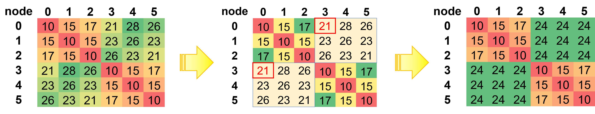
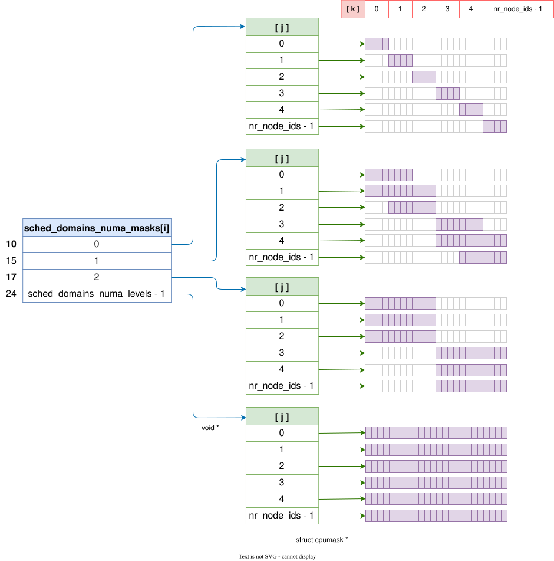

# 调度域拓扑

```c
start_kernel()
-> rest_init()
   -> pid = user_mode_thread(kernel_init, NULL, CLONE_FS);

kernel_init()
-> kernel_init_freeable()
   -> smp_init()
      -> idle_threads_init()  //为所有的 cpus 初始化 idle 线程
      -> cpuhp_threads_init() //为所有的 cpus 初始化热插拔线程
   -> sched_init_smp()
      -> sched_init_numa(NUMA_NO_NODE)
      -> sched_init_domains(cpu_active_mask)
         -> asym_cpu_capacity_scan()
         -> alloc_sched_domains(ndoms_cur = 1)
         -> build_sched_domains(doms_cur[0], NULL)
            -> __visit_domain_allocation_hell()
               -> __sdt_alloc(cpu_map)
               -> __sds_alloc(d, cpu_map)
               -> alloc_rootdomain()
                  -> init_rootdomain(rd)
               for_each_cpu(i, cpu_map) //为每个 CPU
                  for_each_sd_topology(tl) //自底向上
                  -> sd = build_sched_domain(tl, cpu_map, attr, sd, i) //构建调度域
                     -> sd_init(tl, cpu_map, child, cpu)
                     -> set_domain_attribute(sd, attr)
      -> init_sched_rt_class()
      -> init_sched_dl_class()
-> run_init_process() //运行 init 进程
```
* 每个级别的调度域和调度组会在 `__sdt_alloc()` 用 `kzalloc_node()` 分配出来
* arch/x86/include/asm/topology.h
```cpp
/* Topology information */
enum x86_topology_domains {
        TOPO_SMT_DOMAIN,
        TOPO_CORE_DOMAIN,
        TOPO_MODULE_DOMAIN,
        TOPO_TILE_DOMAIN,
        TOPO_DIE_DOMAIN,
        TOPO_DIEGRP_DOMAIN,
        TOPO_PKG_DOMAIN,
        TOPO_MAX_DOMAIN,
};
```

* include/linux/sched/topology.h
```cpp
typedef const struct cpumask *(*sched_domain_mask_f)(struct sched_domain_topology_level *tl, int cpu);
typedef int (*sched_domain_flags_f)(void);

struct sd_data {
        struct sched_domain *__percpu *sd;
        struct sched_group *__percpu *sg;
        struct sched_group_capacity *__percpu *sgc;
};

struct sched_domain_topology_level {
        sched_domain_mask_f mask;
        sched_domain_flags_f sd_flags;
        int                 numa_level;
        struct sd_data      data;
        char                *name;
};
...
#define SDTL_INIT(maskfn, flagsfn, dname) ((struct sched_domain_topology_level) \
            { .mask = maskfn, .sd_flags = flagsfn, .name = #dname })
```

* 缺省 domain level 的定义 `default_topology[]`
  * kernel/sched/core.c
```cpp
/*
 * Topology list, bottom-up.
 */
static struct sched_domain_topology_level default_topology[] = {
#ifdef CONFIG_SCHED_SMT
        SDTL_INIT(tl_smt_mask, cpu_smt_flags, SMT),
#endif

#ifdef CONFIG_SCHED_CLUSTER
        SDTL_INIT(tl_cls_mask, cpu_cluster_flags, CLS),
#endif

#ifdef CONFIG_SCHED_MC
        SDTL_INIT(tl_mc_mask, cpu_core_flags, MC),
#endif
        SDTL_INIT(tl_pkg_mask, NULL, PKG),
        { NULL, },
};
//默认调度域拓扑指向缺省 domain level 数组
static struct sched_domain_topology_level *sched_domain_topology =
        default_topology;
static struct sched_domain_topology_level *sched_domain_topology_saved;

#define for_each_sd_topology(tl)                        \
        for (tl = sched_domain_topology; tl->mask; tl++)
```

## 调度级别

层级 | 内核调度域  | Intel                   | AMD                     | Hygon
-----|------------|-------------------------|-------------------------|------------------------
0    | SMT        | Core                    | SMT                     | SMT
1    | MC         | Tile（在特定架构）       | CCX                     | CCX
2    | PKG        | Die                     | CCD                     | CDD → NODE / NUMA[0]
3    | NODE       | Package                 | Package / NUMA[0]       | Package → NUMA / NUMA[1]
4    | NUMA       | Package hop 1           | Package hop 1 / NUMA[1] | Package hop 1 / NUMA[2]
5    | NUMA       | Package hop 2           | Package hop 2 / NUMA[2] | Package hop 2 / NUMA[3]

* **AMD**
  * 在 EPYC 2 之前，内存控制器在 CCD 上，CCD 也就成了 NUMA 的边界，因此这一级会因为 CPU mask 和 NODE/NUMA[0] 一级相同而被压缩
  * 在 EPYC 2 开始，内存控制器移到了 I/O Die 上，采用了中心架构，因此应该是能看到 `PKG` 这一级的（待求证）？
* **Hygon**
  * Hygon 沿用 Zen1 的架构，内存控制器在 CDD 上，CDD 也就成了 NUMA 的边界，因此 Hygon 的调度级别中没有 `PKG` 这一级，`MC` 之后就到 `NODE`，之后到 `NUMA`
  * CDD 之间可能会由于需要经过多个 hop 导致 NUMA 距离不同，因此在一个 package 内也可能会有多个 NUMA 层级
* 对于 x86 平台，目前还没有使用到 Cluster 层级的

### SMT
* `SMT` 对应到 **Core** 一级的调度
```cpp
//include/linux/topology.h
#if defined(CONFIG_SCHED_SMT) && !defined(cpu_smt_mask)
static inline const struct cpumask *cpu_smt_mask(int cpu)
{
        return topology_sibling_cpumask(cpu);
}
#endif
//kernel/sched/topology.c
const struct cpumask *tl_smt_mask(struct sched_domain_topology_level *tl, int cpu) 
{
        return cpu_smt_mask(cpu);
}
```

### Cluster
* 由 `cpu_l2c_shared_mask()` 可知，`Cluster` 对应的是共享 L2 cache 一级的调度
* `Cluster` 一级在 x86 平台中没有，在一些 ARM 处理器上会出现
```cpp
//arch/x86/kernel/smpboot.c
const struct cpumask *cpu_clustergroup_mask(int cpu)
{               
        return cpu_l2c_shared_mask(cpu);
}

//kernel/sched/topology.c
const struct cpumask *tl_mc_mask(struct sched_domain_topology_level *tl, int cpu)
{
        return cpu_coregroup_mask(cpu);
}
```

### MC
* 由 `cpu_llc_shared_mask()` 可知，这一级对应的是共享 LLC cache 一级的调度
* 对于 AMD，是 CCX（core compute complex）一级
```cpp
//arch/x86/kernel/smpboot.c
const struct cpumask *cpu_coregroup_mask(int cpu)
{
        return cpu_llc_shared_mask(cpu);
}

//kernel/sched/topology.c
const struct cpumask *tl_mc_mask(struct sched_domain_topology_level *tl, int cpu)
{
        return cpu_coregroup_mask(cpu);
}
```

### Package
* 在 AMD 平台的术语中，`node` 指代的是 Die
* 见 APM，CPUID `Fn8000_001E_ECX` Node Identifiers

Bits | Field Name        | Description
-----|-------------------|-------------------
31:0 | —                 | Reserved
10:8 | NodesPerProcessor | Specifies the number of nodes in the package/socket in which this logical processor resides. Node in this context corresponds to a processor die. Encoding is N-1, where N is the number of nodes present in the socket.
7:0  | NodeId            | Specifies the ID of the node containing the current logical processor. NodeId values are unique across the system.

```cpp
//include/linux/topology.h
static inline const struct cpumask *cpu_node_mask(int cpu)
{
        return cpumask_of_node(cpu_to_node(cpu));
}
//kernel/sched/topology.c
const struct cpumask *tl_pkg_mask(struct sched_domain_topology_level *tl, int cpu)
{
        return cpu_node_mask(cpu);
}
```

## 构建调度器所需 NUMA 拓扑

### NUMA 节点间距离数组 `numa_distance[]`
* `numa_distance[i, j]` 是记录 NUMA 节点距离的二维数组
  * `numa_distance_cnt` 是第一维和第二维的最大索引数
* `numa_node_dist()` 函数给出一、二维的索引 `i` 和 `j`，返回这两个节点间的距离
  * 当创建 NUMA 级别调度域时，一些特定的体系结构可以修改它的 NUMA 距离，修改 NUMA 节点组和 NUMA 的级别
```cpp
//mm/numa_memblks.c
int __node_distance(int from, int to)
{
        if (from >= numa_distance_cnt || to >= numa_distance_cnt)
                return from == to ? LOCAL_DISTANCE : REMOTE_DISTANCE;
        return numa_distance[from * numa_distance_cnt + to];
}
//arch/x86/include/asm/topology.h
#define node_distance(a, b) __node_distance(a, b)
//kernel/sched/topology.c
/*
 * An architecture could modify its NUMA distance, to change
 * grouping of NUMA nodes and number of NUMA levels when creating
 * NUMA level sched domains.
 *
 * A NUMA level is created for each unique
 * arch_sched_node_distance.
 */
static int numa_node_dist(int i, int j)
{
        return node_distance(i, j);
}
```
### 验证 SLIT 表的 NUMA 距离
* `slit_cluster_symmetric()` 测试以节点 N 起始的 on-trace cluster 是否对称
  * 使用上三角迭代避免明显重复的比较
```cpp
/*
 * Test if the on-trace cluster at (N,N) is symmetric.
 * Uses upper triangle iteration to avoid obvious duplicates.
 *
 * @N: 当前 cluster 内第一个 NUMA 节点的索引（cluster 起始点）
 * @return: true 表示 cluster 内所有节点对的距离对称，false 表示存在不对称
 */
static bool slit_cluster_symmetric(int N)
{
        int u = topology_num_nodes_per_package(); //每个物理封装内的节点数（cluster 大小）
        //遍历 cluster 内的所有节点对（包括自身，即 k==l 时距离应为 0）
        for (int k = 0; k < u; k++) {
                //内层从 k 开始，仅检查上三角（含对角线），避免重复检查对称对
                for (int l = k; l < u; l++) {
                        // 比较正向距离和反向距离是否相等
                        if (node_distance(N + k, N + l) !=
                            node_distance(N + l, N + k))
                                return false;   //发现不对称，直接返回失败
                }
        }
        //所有节点对的距离都对称
        return true;
}
```

* `slit_cluster_package()` 检查 cluster 内所有节点的每一个 CPU 都是否拥有相同的封装 ID
```cpp
/*
 * Return the package-id of the cluster, or ~0 if indeterminate.
 * Each node in the on-trace cluster should have the same package-id.
 *
 * 返回该 cluster 的物理封装 ID（package-id），若无法确定则返回 ~0。
 * 要求 cluster 内所有节点的每一个 CPU 都拥有相同的封装 ID。
 *
 * @N: 当前 cluster 内第一个 NUMA 节点的索引
 * @return: cluster 的 package-id（一致）或 ~0（不一致/无效）
 */
static u32 slit_cluster_package(int N)
{
        int u = topology_num_nodes_per_package(); //每个物理封装内的节点数（cluster 大小）
        u32 pkg_id = ~0; //初始化为无效值（全 1）
        //遍历 cluster 内的每一个 NUMA 节点
        for (int n = 0; n < u; n++) {
                const struct cpumask *cpus = cpumask_of_node(N + n); //获取归属于该节点的所有 CPU 的掩码
                int cpu;
                // 遍历该节点上的每一个 CPU
                for_each_cpu(cpu, cpus) {
                        u32 id = topology_logical_package_id(cpu); //获取该 CPU 的逻辑封装 ID
                        //第一次设置：记录第一个遇到的封装 ID
                        if (pkg_id == ~0)
                                pkg_id = id;
                        if (pkg_id != id)      //发现不一致的封装 ID，说明该 cluster 跨越了不同的物理封装
                                return ~0;     //返回无效值
                }
        }
        //所有 CPU 的封装 ID 一致，返回该 ID
        return pkg_id;
}
```
* 验证 SLIT 表是否符合 SNC（子 NUMA 集群）所期望的格式，具体要求：
  - 每个 on-trace （即同一个物理封装内的 SNC cluster）内部距离对称
  - 每个 on-trace 拥有一个唯一的物理封装 ID（package-id）
* 如果在 SNC 之上再使用 NUMA_EMU（NUMA 仿真），后果自负。
```cpp
/*
 * Validate the SLIT table is of the form expected for SNC, specifically:
 *
 *  - each on-trace cluster should be symmetric,
 *  - each on-trace cluster should have a unique package-id.
 *
 * If you NUMA_EMU on top of SNC, you get to keep the pieces.
 */
static bool slit_validate(void)
{       //每个物理封装内的 NUMA 节点数（SNC 划分的 cluster 内节点个数）
        int u = topology_num_nodes_per_package();
        u32 pkg_id, prev_pkg_id = ~0;             //当前 cluster 的物理封装 ID 以及上一个 cluster 的 ID
        //遍历每一个物理封装（package）
        for (int pkg = 0; pkg < topology_max_packages(); pkg++) {
                int n = pkg * u;   //当前封装内第一个 NUMA 节点的索引
                //确保 on-trace cluster 内部距离对称，且每个 cluster 拥有不同的封装 ID。
                /*
                 * Ensure the on-trace cluster is symmetric and each cluster
                 * has a different package id.
                 *
                 */
                if (!slit_cluster_symmetric(n))   //检查以节点 n 起始的簇是否内部对称
                        return false;
                pkg_id = slit_cluster_package(n); //获取该簇的物理封装 ID
                if (pkg_id == ~0)                 //无效的 package ID
                        return false;
                if (pkg && pkg_id == prev_pkg_id) //不同封装却得到相同的 ID（冲突）
                        return false;
                //记录当前封装 ID，用于下一次比较
                prev_pkg_id = pkg_id;
        }
        //所有验证通过
        return true;
}
```

### 架构相关的 NUMA 距离计算


* 当启用 SNC（如 Intel 的 Sub-NUMA Clustering）时，一个物理 CPU 封装内会被划分为多个 NUMA 节点组（cluster）
* 为了保证调度器的正确性，SLIT 表需要满足特定条件：
  * 每个 cluster 内部的 NUMA 节点之间的访问距离必须对称（即 `distance[i][j] == distance[j][i]）`
  * 并且每个 cluster 必须拥有唯一的物理封装标识
```cpp
/*
 * Compute a sanitized SLIT table for SNC; notably SNC-3 can end up with
 * asymmetric off-trace clusters, reflecting physical assymmetries. However
 * this leads to 'unfortunate' sched_domain configurations.
 *
 * 为 SNC（子 NUMA 集群）计算一个经过清理的 SLIT 表；尤其是 SNC-3 会导致 off-trace cluster 的不对称性，
 * 反映了物理上的不对称。然而这会导致调度域配置出现不理想的情况。
 *
 * For example dual socket GNR with SNC-3:
 * 例如双路 GNR（Granite Rapids）处理器配置 SNC-3 时的节点距离矩阵示例：
 *
 * node distances:
 * node     0    1    2    3    4    5
 *     0:   10   15   17   21   28   26
 *     1:   15   10   15   23   26   23
 *     2:   17   15   10   26   23   21
 *     3:   21   28   26   10   15   17
 *     4:   23   26   23   15   10   15
 *     5:   26   23   21   17   15   10
 *
 * Fix things up by averaging out the off-trace clusters; resulting in:
 * 通过对 off-trace clusters 的距离进行平均化处理来修正，得到如下对称的距离矩阵：
 *
 * node     0    1    2    3    4    5
 *     0:   10   15   17   24   24   24
 *     1:   15   10   15   24   24   24
 *     2:   17   15   10   24   24   24
 *     3:   24   24   24   10   15   17
 *     4:   24   24   24   15   10   15
 *     5:   24   24   24   17   15   10
 */
static int slit_cluster_distance(int i, int j)
{
        static int slit_valid = -1;   //静态标志，记录 SLIT 表是否满足 SNC 修正的条件（-1:未初始化，0:无效，1:有效）
        int u = topology_num_nodes_per_package(); //每个物理 CPU 封装内的 NUMA 节点数（即 SNC 划分的簇内节点数）
        long d = 0;                   //用于累加距离和的临时变量
        int x, y;

        if (slit_valid < 0) {         //首次调用时进行验证
                slit_valid = slit_validate(); //检查 SLIT 表是否符合 SNC 修正所需的格式（例如对称性、跨 cluster 距离不等）
                if (!slit_valid)
                        pr_err(FW_BUG "SLIT table doesn't have the expected form for SNC -- fixup disabled!\n");
                else
                        pr_info("Fixing up SNC SLIT table.\n");
        }
        //这两个节点是否属于同一个物理封装内的同一个 SNC cluster？
        /*
         * Is this a unit cluster on the trace?
         */
        if ((i / u) == (j / u) || !slit_valid)
                return node_distance(i, j);  // 同 cluster 或 SLIT 表无效时，直接返回原始距离
        //不同 cluster（Off-trace）的情况。
        /*
         * Off-trace cluster.
         *
         * Notably average out the symmetric pair of off-trace clusters to
         * ensure the resulting SLIT table is symmetric.
         * 注意：对两个 off-trace clusters 之间的对称对进行平均，以保证修正后的 SLIT 表是对称的。
         */
        x = i - (i % u);  //节点 i 所在 cluster 的起始节点编号
        y = j - (j % u);  //节点 j 所在 cluster 的起始节点编号
        //遍历 cluster x 和 cluster y 中的所有节点对（双向），累加所有距离
        for (i = x; i < x + u; i++) {
                for (j = y; j < y + u; j++) {
                        d += node_distance(i, j); //累加正向距离
                        d += node_distance(j, i); //累加反向距离（确保对称性）
                }
        }
        //返回平均距离：总距离除以节点对总数（2 * u * u，因为每个方向都加了一次）
        return d / (2*u*u);
}
```

* `arch_sched_node_distance()` 是架构相关的 NUMA 节点距离计算函数，供调度器使用
  * 该函数主要用于处理特定 Intel CPU 上 SNC（Sub-NUMA Clustering）导致的不对称距离问题
  * 对于普通系统，直接返回 ACPI SLIT 表中的原始距离
```cpp
/*
 * @from: 源节点编号
 * @to:   目标节点编号
 *
 * 返回值：节点间的距离值，数值越小表示越“近”，调度器会优先选择近的节点。
 */
int arch_sched_node_distance(int from, int to)
{
        int d = node_distance(from, to); //获取 BIOS 提供的原始 NUMA 距离

        // 根据 CPU 型号决定是否需要修正
        switch (boot_cpu_data.x86_vfm) {
        case INTEL_GRANITERAPIDS_X:   //Intel Granite Rapids X 系列
        case INTEL_ATOM_DARKMONT_X:   //Intel Atom Darkmont X 系列
                //如果系统只有一个物理封装，或者每个封装内的节点数小于 3（即 SNC-2 或未启用 SNC-3），
                //则直接返回原始距离，因为不存在需要修正的非对称性。
                if (topology_max_packages() == 1 ||
                    topology_num_nodes_per_package() < 3)
                        return d;
                /*
                 * Handle SNC-3 asymmetries.
                 * 处理 SNC-3 导致的不对称距离问题。
                 */
                return slit_cluster_distance(from, to); // 调用上述平均化修正函数
        }
        return d; // 其他 CPU 型号不做修正
}
```
### 记录并提取 NUMA 节点间的所有唯一距离值
* `sched_record_numa_dist()` 记录并提取 NUMA 节点间的所有 **唯一距离值**
  * 遍历所有在线 NUMA 节点对，收集节点间距离值，利用 bitmap 去重，最终得到一组从小到大排列的、不重复的距离值，用于构建 NUMA 调度层级。
  * 例如，典型值可能为 `[10, 20, 30]` 分别代表本地、同一 NUMA 域、跨域等。
```cpp
//include/linux/topology.h
#define DISTANCE_BITS           8
//kernel/sched/topology.c
#define NR_DISTANCE_VALUES (1 << DISTANCE_BITS)

/*
 * sched_record_numa_dist - 记录并提取 NUMA 节点间的所有唯一距离值
 * @offline_node: 需要忽略的离线节点（通常为 NUMA_NO_NODE 或特定离线节点）
 * @n_dist:       用于获取两个节点间距离的回调函数，返回整型距离值
 * @dist:         输出参数：动态分配的数组，存储所有升序排列的唯一距离值
 * @levels:       输出参数：唯一距离值的个数（即 NUMA 距离等级数）
 *
 * 返回值：0 表示成功，负错误码表示失败（-ENOMEM 或 -EINVAL）
 */
static int sched_record_numa_dist(int offline_node, int (*n_dist)(int, int),
                                  int **dist, int *levels)
{
        unsigned long *distance_map __free(bitmap) = NULL; //位图，用于标记哪些距离值已出现（内存由 __free 自动释放）
        int i, j;
        int *distances;

        /*
         * O(nr_nodes^2) de-duplicating selection sort -- in order to find the
         * unique distances in the node_distance() table.
         *
         * 采用 O(节点数^2) 的去重选择排序 —— 目的是找出 node_distance() 表中所有唯一的距离值。
         * 这里使用 bitmap 代替实际排序：因为距离值范围有限（NR_DISTANCE_VALUES 一般为 32 或 64），
         * 只需将出现的距离值在位图中对应位置标记，最后顺序扫描即可得到排序后的唯一值。
         */
        distance_map = bitmap_alloc(NR_DISTANCE_VALUES, GFP_KERNEL); //分配位图，大小等于可能距离值的总数（如 0~63）
        if (!distance_map)
                return -ENOMEM;
        //清空位图
        bitmap_zero(distance_map, NR_DISTANCE_VALUES);
        /* 遍历所有在线节点对（跳过 offline_node） */
        for_each_cpu_node_but(i, offline_node) {           //外层循环：节点 i
                for_each_cpu_node_but(j, offline_node) {   //内层循环：节点 j
                        int distance = n_dist(i, j);       //获取节点 i 与 j 之间的 NUMA 距离
                        /* 校验距离值是否在合法范围内 [LOCAL_DISTANCE, NR_DISTANCE_VALUES) */
                        if (distance < LOCAL_DISTANCE || distance >= NR_DISTANCE_VALUES) {
                                sched_numa_warn("Invalid distance value range");
                                return -EINVAL;
                        }
                        //将该距离值在位图中对应的比特位置 1（去重标记）
                        bitmap_set(distance_map, distance, 1);
                }
        }
        /*
         * We can now figure out how many unique distance values there are and
         * allocate memory accordingly.
         *
         * 现在可以知道有多少个唯一距离值，并据此分配内存。
         */
        nr_levels = bitmap_weight(distance_map, NR_DISTANCE_VALUES); //统计位图中置 1 的位数 = 唯一距离值的个数
        //为存储唯一距离值分配数组空间
        distances = kzalloc_objs(int, nr_levels);
        if (!distances)
                return -ENOMEM;
        /* 按升序遍历位图，将所有置 1 位的索引（即距离值）取出，存入 distances 数组 */
        for (i = 0, j = 0; i < nr_levels; i++, j++) {
                j = find_next_bit(distance_map, NR_DISTANCE_VALUES, j); //找到下一个置 1 的比特位
                distances[i] = j;   //将该比特位的索引（即距离值）保存
        }

        *dist = distances;   //通过输出参数返回距离数组
        *levels = nr_levels; //返回等级数量

        return 0;
}
```
### 调度器所需 NUMA 拓扑初始化

* `sched_init_numa()` 初始化调度器所需的 NUMA 拓扑信息，该函数完成以下主要工作：
  1. 从 SLIT 表中记录节点间的原始 NUMA 距离，并存储唯一距离值；
  2. 若架构提供了修正后的距离函数（如 SNC 场景），则记录修正后的距离；
  3. 为每个 NUMA 距离等级构建对应的 CPU 掩码（表示距当前节点该跳数以内的所有 CPU）；
  4. 扩展默认的调度域拓扑，追加 `NODE` 层和 `NUMA` 层；
  5. 更新全局的调度域拓扑指针，使调度器能够使用 NUMA 感知的负载均衡。

* 例如，根据之前代码中举例的架构相关的 NUMA 层级可以构造出 `sched_domains_numa_masks[]` 如下：
  * 经过修正后，`nr_levels` 压缩成 4 个 NUMA 层级（10、15、17、24）
  * 然而，NUMA 节点的实际个数 `nr_node_ids` 不会因此而改变，仍然是 6 个
  * 假设每个 NUMA 节点上有 4 个逻辑 CPU，每个 CPU 在 `cpumask` 中用 1 个 bit 表示



```cpp
#ifdef CONFIG_NUMA
enum numa_topology_type sched_numa_topology_type; //NUMA 拓扑类型：直接、无粘合网状、背板

/*
 * sched_domains_numa_distance is derived from sched_numa_node_distance
 * and provides a simplified view of NUMA distances used specifically
 * for building NUMA scheduling domains.
 */
static int          sched_domains_numa_levels;    //修正后的距离的唯一层级数量
static int          sched_numa_node_levels;       //原始的距离的唯一层级数量

int                 sched_max_numa_distance;      //最大（即最远的层级）的 NUMA 距离值
//由 sched_numa_node_distance[] 衍生而来，提供 NUMA 距离的简化视图，用于构建特定的 NUMA 调度域
static int          *sched_domains_numa_distance;
static int          *sched_numa_node_distance;    //原始距离数组，来自 SLIT 表
static struct cpumask       ***sched_domains_numa_masks; //这部分最终目的都是为了构造这个表
#endif /* CONFIG_NUMA */
...
/*
 * @offline_node: 需要排除的离线节点（通常为 NUMA_NO_NODE）
 */
void sched_init_numa(int offline_node)
{
        struct sched_domain_topology_level *tl;
        int nr_levels, nr_node_levels;
        int i, j;
        int *distances, *domain_distances; //前者记录原始距离。后者记录修正距离，无修正则共享原始距离数组
        struct cpumask ***masks;
        //从 SLIT 表中记录原始的 NUMA 距离（使用 node_distance 函数）
        /* Record the NUMA distances from SLIT table */
        if (sched_record_numa_dist(offline_node, numa_node_dist, &distances,
                                   &nr_node_levels))
                return;  //记录失败（内存不足或距离值非法），直接返回
       //若架构提供了修正后的距离函数（例如处理 SNC 不对称），则重新记录修正后的距离值，否则直接使用原始距离
        /* Record modified NUMA distances for building sched domains */
        if (modified_sched_node_distance()) {
                if (sched_record_numa_dist(offline_node, arch_sched_node_distance,
                                           &domain_distances, &nr_levels)) {
                        kfree(distances);  //修正距离记录失败，释放已分配的原始距离数组
                        return;
                }
        } else {
                domain_distances = distances; //无修正，直接共享原始距离数组
                nr_levels = nr_node_levels;   //无修正，用原始 NUMA 层级数
        }
        //将原始距离数组暴露给全局（供调试或其它模块使用）
        rcu_assign_pointer(sched_numa_node_distance, distances);
        //记录最大的 NUMA 距离值（即最远的层级）
        WRITE_ONCE(sched_max_numa_distance, distances[nr_node_levels - 1]);
        //记录原始的距离的唯一等级数量
        WRITE_ONCE(sched_numa_node_levels, nr_node_levels);
        //nr_levels 存储了唯一距离值的个数（即 NUMA 层级数，有可能被修正过）
        //sched_domains_numa_distance[] 数组存放具体的距离数值
        /*
         * 'nr_levels' contains the number of unique distances
         *
         * The sched_domains_numa_distance[] array includes the actual distance
         * numbers. 
         */
        //这里先将 sched_domains_numa_levels 临时置为 0，以避免在后续分配 sched_domains_numa_masks[][]
        //失败时其他函数遍历未完全初始化的 masks 数组 sched_domains_numa_masks[][] 造成危险。
        //在函数末尾会将其恢复为 nr_levels。
        /*
         * Here, we should temporarily reset sched_domains_numa_levels to 0.
         * If it fails to allocate memory for array sched_domains_numa_masks[][],
         * the array will contain less then 'nr_levels' members. This could be
         * dangerous when we use it to iterate array sched_domains_numa_masks[][]
         * in other functions.
         *
         * We reset it to 'nr_levels' at the end of this function.
         */
        rcu_assign_pointer(sched_domains_numa_distance, domain_distances);
        sched_domains_numa_levels = 0;
        //为每个 NUMA 层级分配一级指针数组（每个等级对应一个节点的掩码列表）
        masks = kzalloc(sizeof(void *) * nr_levels, GFP_KERNEL);
        if (!masks)
                return;

        /*
         * Now for each level, construct a mask per node which contains all
         * CPUs of nodes that are that many hops away from us.
         *
         * 对于每一个 NUMA 距离层级，为每个节点构造一个 cpumask，
         * 该 mask 包含所有距离当前节点 <= 该层级距离的节点上的所有 CPU。
         * 即：对于节点 j，等级 i 的 mask 包含所有满足
         *   arch_sched_node_distance(j, k) <= sched_domains_numa_distance[i]
         * 的节点 k 上的全部 CPU。
         */
        for (i = 0; i < nr_levels; i++) {
                /* 为第 i 级分配一个指针数组，长度为 nr_node_ids，每个元素指向一个 cpumask */
                masks[i] = kzalloc(nr_node_ids * sizeof(void *), GFP_KERNEL);
                if (!masks[i])
                        return;
                //遍历每一个在线节点（跳过 offline_node）
                for_each_cpu_node_but(j, offline_node) {
                        struct cpumask *mask = kzalloc(cpumask_size(), GFP_KERNEL);
                        int k;

                        if (!mask)
                                return;
                        //存储该节点 j 在第 i 级的 cpumask
                        masks[i][j] = mask;
                        //遍历所有可能的其他节点 k，将符合条件的节点 CPU 加入 mask
                        for_each_cpu_node_but(k, offline_node) {
                                //调试模式：检查距离对称性（若不对称则告警）
                                if (sched_debug() &&
                                    (arch_sched_node_distance(j, k) !=
                                     arch_sched_node_distance(k, j)))
                                        sched_numa_warn("Node-distance not symmetric");
                                //若节点 k 到节点 j 的距离大于当前等级的距离阈值，则跳过
                                if (arch_sched_node_distance(j, k) >
                                    sched_domains_numa_distance[i])
                                        continue;
                                //将节点 k 上的所有 CPU 并入当前 mask
                                cpumask_or(mask, mask, cpumask_of_node(k));
                        }
                }
        }
        //将构造好的 masks 数组发布到全局
        rcu_assign_pointer(sched_domains_numa_masks, masks);
        //计算默认调度域拓扑的条目数（以空 mask 为终止标记）
        /* Compute default topology size */
        for (i = 0; sched_domain_topology[i].mask; i++);
        /* 分配新的拓扑数组：原有默认条目 + NUMA 增加的 NODE 层 + (nr_levels-1) 个 NUMA 层 + 终止符 */
        tl = kzalloc((i + nr_levels + 1) *
                        sizeof(struct sched_domain_topology_level), GFP_KERNEL);
        if (!tl)
                return;
        //复制默认的拓扑层级（如 SMT，MC，PKG 等）
        /*
         * Copy the default topology bits..
         */
        for (i = 0; sched_domain_topology[i].mask; i++)
                tl[i] = sched_domain_topology[i];
        //添加 NUMA 身份距离层，即一个 NUMA 节点自身（对应距离为 LOCAL_DISTANCE）
        /*
         * Add the NUMA identity distance, aka single NODE.
         */
        tl[i++] = SDTL_INIT(sd_numa_mask, NULL, NODE);
        //追加剩余的 NUMA 层级（从第 1 级到第 nr_levels-1 级）
        //注意：第 0 级（LOCAL_DISTANCE）已经由 NODE 层覆盖，所以从 j=1 开始。
        /*
         * .. and append 'j' levels of NUMA goodness.
         */
        for (j = 1; j < nr_levels; i++, j++) {
                tl[i] = SDTL_INIT(sd_numa_mask, cpu_numa_flags, NUMA);
                tl[i].numa_level = j;   //记录该层对应的 NUMA 距离等级索引
        }
        //此时 tl 数组最后一个元素由 kzalloc 隐式填充为 { NULL, }
        //保存原有的拓扑指针，以便恢复（目前仅用于调试或热插拔重置）
        sched_domain_topology_saved = sched_domain_topology;
        //将新的拓扑指针发布到全局，后续调度域构建将使用此拓扑
        sched_domain_topology = tl;
        //最后将 sched_domains_numa_levels 恢复为真实的 NUMA 层级数
        sched_domains_numa_levels = nr_levels;
        //根据 NUMA 拓扑类型（如扁平、分层等）设置全局 numa_topology_type
        init_numa_topology_type(offline_node);
}
```
* 理解了调度域 NUMA 层级 masks 数组 `sched_domains_numa_masks[i][j]` 的构建过程，就不难理解返回调度域 CPU 掩码的函数 `sd_numa_mask()`
```cpp
static const struct cpumask *sd_numa_mask(struct sched_domain_topology_level *tl, int cpu) 
{
    return sched_domains_numa_masks[tl->numa_level][cpu_to_node(cpu)];
}
```
#### 初始化 NUMA 拓扑类型
* 系统可能存在三种 NUMA 拓扑类型：
  * **NUMA_DIRECT**:        所有节点直接相连，或者根本不是 NUMA 系统
  * **NUMA_GLUELESS_MESH**: 部分节点需通过中间节点才能到达
  * **NUMA_BACKPLANE**:     节点通过背板控制器相连
* *无粘合网状拓扑* 与 *背板拓扑* 的区别在于：非直接相连的节点之间的通信是经过可运行程序的中间节点，还是经过背板控制器。这会影响程序的放置策略。
* 可通过以下测试辨别拓扑类型：
  - 如果任意两个节点之间的最大距离为 1 跳，则为直连系统。
  - 如果存在两个节点 A 和 B，它们相距 N > 1 跳，并且存在一个中间节点 C，使得 C 到 A 和 C 到 B 的距离都小于 N 跳，则为无粘合网状拓扑。

```cpp
/*
 * A system can have three types of NUMA topology:
 * NUMA_DIRECT: all nodes are directly connected, or not a NUMA system
 * NUMA_GLUELESS_MESH: some nodes reachable through intermediary nodes
 * NUMA_BACKPLANE: nodes can reach other nodes through a backplane
 *
 * The difference between a glueless mesh topology and a backplane
 * topology lies in whether communication between not directly
 * connected nodes goes through intermediary nodes (where programs
 * could run), or through backplane controllers. This affects
 * placement of programs.
 *
 * The type of topology can be discerned with the following tests:
 * - If the maximum distance between any nodes is 1 hop, the system
 *   is directly connected.
 * - If for two nodes A and B, located N > 1 hops away from each other,
 *   there is an intermediary node C, which is < N hops away from both
 *   nodes A and B, the system is a glueless mesh.
 */
static void init_numa_topology_type(int offline_node)
{
        int a, b, c, n;
        //记录当前系统中最大的 NUMA 距离值（即最远的层级）
        n = sched_max_numa_distance;
        //如果 NUMA 层级数 <= 2，说明最多只有本地和远程两个距离等级，可视为直连
        if (sched_domains_numa_levels <= 2) {
                sched_numa_topology_type = NUMA_DIRECT;
                return;
        }
        //遍历所有在线 NUMA 节点（跳过指定的离线节点）
        for_each_cpu_node_but(a, offline_node) {
                for_each_cpu_node_but(b, offline_node) {
                        //寻找相距最远的两个节点（距离达到最大距离 n），这里用的是真实距离，不是修正距离
                        /* Find two nodes furthest removed from each other. */
                        if (node_distance(a, b) < n)
                                continue;
                        //在 a 和 b 之间是否存在一个中间节点 c，使得 c 到 a 和 c 到 b 的距离都小于最大距离 n？
                        /* Is there an intermediary node between a and b? */
                        for_each_cpu_node_but(c, offline_node) {
                                if (node_distance(a, c) < n &&
                                    node_distance(b, c) < n) {
                                        sched_numa_topology_type =
                                                        NUMA_GLUELESS_MESH;
                                        return;  //存在这样的中间节点，判定为无粘合网状拓扑
                                }
                        }
                        //不存在这样的中间节点，说明跨距离通信必须经过背板
                        sched_numa_topology_type = NUMA_BACKPLANE;
                        return;
                }
        }
        // 如果未能通过上述逻辑确定类型（理论上不会发生），回退到直连并打印错误
        pr_err("Failed to find a NUMA topology type, defaulting to DIRECT\n");
        sched_numa_topology_type = NUMA_DIRECT;
}
```

## 构建调度域

### 数据结构 `struct s_data`
* 调度域数据结构 `struct sched_domain`
  * include/linux/sched/topology.h
```cpp
struct sched_domain {
        /* These fields must be setup */
        struct sched_domain __rcu *parent;      /* top domain must be null terminated */
        struct sched_domain __rcu *child;       /* bottom domain must be null terminated */
        struct sched_group *groups;     /* the balancing groups of the domain */
        unsigned long min_interval;     /* Minimum balance interval ms */
        unsigned long max_interval;     /* Maximum balance interval ms */
        unsigned int busy_factor;       /* less balancing by factor if busy */
        unsigned int imbalance_pct;     /* No balance until over watermark */
        unsigned int cache_nice_tries;  /* Leave cache hot tasks for # tries */
        unsigned int imb_numa_nr;       /* Nr running tasks that allows a NUMA imbalance */

        int nohz_idle;                  /* NOHZ IDLE status */
        int flags;                      /* See SD_* */
        int level;

        /* Runtime fields. */
        unsigned long last_balance;     /* init to jiffies. units in jiffies */
        unsigned int balance_interval;  /* initialise to 1. units in ms. */
        unsigned int nr_balance_failed; /* initialise to 0 */

        /* idle_balance() stats */
        unsigned int newidle_call;
        unsigned int newidle_success;
        unsigned int newidle_ratio;
        u64 newidle_stamp;
        u64 max_newidle_lb_cost;
        unsigned long last_decay_max_lb_cost;

#ifdef CONFIG_SCHEDSTATS
        /* sched_balance_rq() stats */
        unsigned int lb_count[CPU_MAX_IDLE_TYPES];
        unsigned int lb_failed[CPU_MAX_IDLE_TYPES];
        unsigned int lb_balanced[CPU_MAX_IDLE_TYPES];
        unsigned int lb_imbalance_load[CPU_MAX_IDLE_TYPES];
        unsigned int lb_imbalance_util[CPU_MAX_IDLE_TYPES];
        unsigned int lb_imbalance_task[CPU_MAX_IDLE_TYPES];
        unsigned int lb_imbalance_misfit[CPU_MAX_IDLE_TYPES];
        unsigned int lb_gained[CPU_MAX_IDLE_TYPES];
        unsigned int lb_hot_gained[CPU_MAX_IDLE_TYPES];
        unsigned int lb_nobusyg[CPU_MAX_IDLE_TYPES];
        unsigned int lb_nobusyq[CPU_MAX_IDLE_TYPES];

        /* Active load balancing */
        unsigned int alb_count;
        unsigned int alb_failed;
        unsigned int alb_pushed;

        /* SD_BALANCE_EXEC stats */
        unsigned int sbe_count;
        unsigned int sbe_balanced;
        unsigned int sbe_pushed;

        /* SD_BALANCE_FORK stats */
        unsigned int sbf_count;
        unsigned int sbf_balanced;
        unsigned int sbf_pushed;

        /* try_to_wake_up() stats */
        unsigned int ttwu_wake_remote;
        unsigned int ttwu_move_affine;
        unsigned int ttwu_move_balance;
#endif
        char *name;
        union {
                void *private;          /* used during construction */
                struct rcu_head rcu;    /* used during destruction */
        };
        struct sched_domain_shared *shared;

        unsigned int span_weight;
        /*
         * See sched_domain_span(), on why flex arrays are broken.
         *
        unsigned long span[];
         */
};
```
* 本地变量 `struct s_data d` 保存所有分配的数据（域、组、根域等）
```cpp
struct s_data {
        struct sched_domain_shared * __percpu *sds;
        struct sched_domain * __percpu *sd;
        struct root_domain      *rd;
};
```

### 构建调度域 `build_sched_domains()`
* `build_sched_domains()` 为指定的 CPU 集合构建调度域层次结构，主要流程如下：
1. 分配所需的所有调度域、调度组、根域等内存。
2. 对每个 CPU，根据预定义的拓扑层级（从 `SMT` 到 `NUMA[n]`）自下而上构建调度域。
3. 为每个调度域构建其包含的调度组（用于负载均衡）。
4. 关联共享 LLC 的调度域，并初始化负载均衡统计。
5. 计算各调度组的 CPU 容量（用于负载均衡）。
6. 将构建好的调度域挂载到每个 CPU 的运行队列上。
7. 启用必要的静态分支（如非对称 CPU 容量、集群特性）。
```cpp
/*
 * @cpu_map: 需要构建调度域的 CPU 位图（通常为所有在线 CPU）
 * @attr:    调度域属性（通常为 NULL）
 *
 * 返回值：0 表示成功，负错误码表示失败（-ENOMEM 等）
 */
build_sched_domains(const struct cpumask *cpu_map, struct sched_domain_attr *attr)
{
        enum s_alloc alloc_state = sa_none;   //内存分配阶段状态，用于错误回滚
        struct sched_domain *sd;              //当前构建的调度域指针
        struct s_data d;                      //保存所有分配的数据（域、组、根域等）
        struct rq *rq = NULL;                 //用于最后打印调试信息的运行队列指针
        int i, ret = -ENOMEM;                 //循环变量与返回值
        bool has_asym = false;                //是否存在非对称 CPU 容量（如 big.LITTLE）
        bool has_cluster = false;             //是否存在 CLUSTER 域层级
        //如果 cpu_map 为空，则无法构建，直接跳转到错误处理
        if (WARN_ON(cpumask_empty(cpu_map)))
                goto error;
        //1. 分配所有需要的数据结构（根域、调度域指针数组、调度组等），该函数名带“hell”是调侃其分配过程复杂
        alloc_state = __visit_domain_allocation_hell(&d, cpu_map);
        if (alloc_state != sa_rootdomain)      //分配失败（未达到根域分配阶段）
                goto error;
        //2. 为 cpu_map 中指定的每个 CPU 建立调度域层级
        /* Set up domains for CPUs specified by the cpu_map: */
        for_each_cpu(i, cpu_map) {
                struct sched_domain_topology_level *tl;

                sd = NULL;
                //由底向上遍历所有拓扑层级（从 SMT 到 NUMA[n]）
                for_each_sd_topology(tl) {
                        //为当前 CPU 构建一个调度域，并链接为前（下）一层的父域（sd 作为子域）
                        sd = build_sched_domain(tl, cpu_map, attr, sd, i);
                        //记录是否拥有非对称 CPU 容量标志
                        has_asym |= sd->flags & SD_ASYM_CPUCAPACITY;
                        //如果是第一个层级（通常是最底层），保存到 per-CPU 指针中
                        if (tl == sched_domain_topology)
                                *per_cpu_ptr(d.sd, i) = sd;
                        //如果当前域的 CPU 集合已经等于 cpu_map（到达顶层），则停止构建
                        if (cpumask_equal(cpu_map, sched_domain_span(sd)))
                                break;
                }
        }
        //检查构建的拓扑是否合理（例如没有重叠或空洞）
        if (WARN_ON(!topology_span_sane(cpu_map)))
                goto error;
        //3. 为每个域构建调度组（用于负载均衡）
        /* Build the groups for the domains */
        for_each_cpu(i, cpu_map) {
                for (sd = *per_cpu_ptr(d.sd, i); sd; sd = sd->parent) {//最底层域开始向上遍历
                        sd->span_weight = cpumask_weight(sched_domain_span(sd));//计算域包含的 CPU 数量
                        if (sd->flags & SD_NUMA) { //NUMA 域的组可能重叠，使用专门函数构建
                                if (build_overlap_sched_groups(sd, i))
                                        goto error;
                        } else {
                                if (build_sched_groups(sd, i))
                                        goto error;
                        }
                }
        }
        //4. 处理共享 LLC 的域（通常为 MC 或 CLS 层级）
        for_each_cpu(i, cpu_map) {
                sd = *per_cpu_ptr(d.sd, i); //从最底层开始找起
                if (!sd)
                        continue;
                //首先找到最顶层的具有 SD_SHARE_LLC 标志的域（即共享最后一级缓存的最高层级域）
                /* First, find the topmost SD_SHARE_LLC domain */
                while (sd->parent && (sd->parent->flags & SD_SHARE_LLC))
                        sd = sd->parent;

                if (sd->flags & SD_SHARE_LLC) {
                        //使用该域中第一个 CPU 的共享数据结构（每个 LLC 域共享一个）
                        int sd_id = cpumask_first(sched_domain_span(sd));

                        sd->shared = *per_cpu_ptr(d.sds, sd_id);
                        //初始化活跃 CPU 计数为该域包含的 CPU 数
                        atomic_set(&sd->shared->nr_busy_cpus, sd->span_weight);
                        atomic_inc(&sd->shared->ref);  //引用计数增加
                        //如果存在更高层域（如 NUMA），调整该层的 NUMA 不平衡统计参数
                        /*
                         * In presence of higher domains, adjust the
                         * NUMA imbalance stats for the hierarchy.
                         */
                        if (IS_ENABLED(CONFIG_NUMA) && sd->parent)
                                adjust_numa_imbalance(sd);
                }
        }
        //5. 计算物理封装和节点级别的 CPU 容量（用于负载均衡的算力值）
        /* Calculate CPU capacity for physical packages and nodes */
        for (i = nr_cpumask_bits-1; i >= 0; i--) {
                if (!cpumask_test_cpu(i, cpu_map))
                        continue;
                //确保 per-CPU 的数据已分配
                claim_allocations(i, &d);
                //从最底层域到顶层域，初始化每个域内调度组的容量信息
                for (sd = *per_cpu_ptr(d.sd, i); sd; sd = sd->parent)
                        init_sched_groups_capacity(i, sd);
        }
        //6. 将构建好的调度域挂载到每个 CPU 的运行队列上，并切换使用新域
        /* Attach the domains */
        rcu_read_lock();  //RCU 保护，防止并发访问
        for_each_cpu(i, cpu_map) {
                rq = cpu_rq(i);
                sd = *per_cpu_ptr(d.sd, i);
                //将域附加到 CPU 运行队列
                cpu_attach_domain(sd, d.rd, i);
                //检查该 CPU 是否拥有 CLUSTER 层级域（用于后续启用静态分支）
                if (lowest_flag_domain(i, SD_CLUSTER))
                        has_cluster = true;
        }
        rcu_read_unlock();
        //7. 如果存在非对称 CPU 容量，启用对应的静态分支（优化调度快速路径）
        if (has_asym)
                static_branch_inc_cpuslocked(&sched_asym_cpucapacity);
        //如果存在 cluster 域，启用 cluster 调度相关静态分支
        if (has_cluster)
                static_branch_inc_cpuslocked(&sched_cluster_active);
        //调试模式下打印根域覆盖的 CPU 范围
        if (rq && sched_debug_verbose)
                pr_info("root domain span: %*pbl\n", cpumask_pr_args(cpu_map));
        //成功
        ret = 0;
error:  //释放所有分配的内存（根据 alloc_state 决定释放哪些部分）
        __free_domain_allocs(&d, alloc_state, cpu_map);

        return ret;
}
```

#### 1. 分配所需的内存
* `enum s_alloc` 为内存分配阶段状态，用于错误回滚
```cpp
enum s_alloc {
        sa_rootdomain,
        sa_sd,
        sa_sd_shared,
        sa_sd_storage,
        sa_none,
};
```
* `__visit_domain_allocation_hell()` 作为调度域内存分配的总入口，返回 `enum s_alloc` 告知分配进行到了哪个阶段
```c
static enum s_alloc  
__visit_domain_allocation_hell(struct s_data *d, const struct cpumask *cpu_map)
{
        memset(d, 0, sizeof(*d));

        if (__sdt_alloc(cpu_map)) //为调度域拓扑的每个层级分配 per-CPU 数据结构
                return sa_sd_storage;
        if (__sds_alloc(d, cpu_map)) //为共享调度域结构分配 per-CPU 数据结构
                return sa_sd_shared;
        d->sd = alloc_percpu(struct sched_domain *);
        if (!d->sd)
                return sa_sd_shared;
        d->rd = alloc_rootdomain(); //根域主要用于实时进程负载均衡
        if (!d->rd)
                return sa_sd;

        return sa_rootdomain;
}
```
##### `__sdt_alloc()`
* `__sdt_alloc()` 为调度域拓扑的每个层级分配 per-CPU 数据结构
  * 该函数为每个拓扑层级（如 `SMT`、`MC`、`PKG`、`NUMA`等）预先分配 per-CPU 指针数组
  * 并为 `cpu_map` 中的每个 CPU 分别分配对应的结构体的实例
    * 调度域（`sched_domain`）
    * 调度组（`sched_group`）
    * 调度组容量（`sched_group_capacity`）
  * 这些结构体将在后续的域构建和组构建阶段被填充具体信息
* 以上数据结构的用途简述如下

数据结构        | 作用
---------------|-----------
`sched_domain` | 代表一个调度域，包含该域覆盖的 CPU 位图、标志、父/子域指针、负载均衡相关参数等
`sched_group`  | 代表域内的一组 CPU（通常共享某级缓存或物理封装），是负载均衡的最小单位。每个 CPU 在域中属于一个组，组内通过 `next` 指针形成链表
`sched_group_capacity` | 存储组的计算能力（capacity）、活跃 CPU 数量等，供负载均衡器使用以决定任务分配

* **per-CPU 存储**：每个 CPU 都独立持有指向其所在域、组和容量结构的指针，以便在调度时快速访问本地数据结构，避免锁竞争
* **预先分配**：在正式构建拓扑关系之前一次性分配所有内存，使后续构建过程更稳定，且便于错误回滚（通过 `__free_domain_allocs()`）
* **NUMA 感知**：使用 `kzalloc_node()` 在 CPU 所在节点分配内存，提升缓存访问效率

```cpp
/*
 * @cpu_map: 需要构建调度域的 CPU 位图
 * 返回值：0 表示成功，-ENOMEM 表示内存分配失败
 */
static int __sdt_alloc(const struct cpumask *cpu_map)
{
        struct sched_domain_topology_level *tl; //当前拓扑层级
        int j;                                  //CPU 编号循环变量
        //遍历所有调度域拓扑层级（从 SMT 到 NUMA[n]）
        for_each_sd_topology(tl) {
                struct sd_data *sdd = &tl->data; //该层级的 per-CPU 数据容器
                //分配 per-CPU 指针数组，用于存储该层级中每个 CPU 的调度域指针。
                //实际指向的 sched_domain 结构体将在下面的循环中逐个分配。
                sdd->sd = alloc_percpu(struct sched_domain *);
                if (!sdd->sd)
                        return -ENOMEM;
                //分配 per-CPU 指针数组，用于存储该层级中每个 CPU 的调度组指针。
                //调度组是负载均衡的基本单位，通常代表共享某级资源的 CPU 子集。
                sdd->sg = alloc_percpu(struct sched_group *);
                if (!sdd->sg)
                        return -ENOMEM;
                //分配 per-CPU 指针数组，用于存储该层级中每个 CPU 的调度组容量信息。
                //容量信息包括该组的算力（capacity）、活跃 CPU 计数等，用于负载均衡决策。
                sdd->sgc = alloc_percpu(struct sched_group_capacity *);
                if (!sdd->sgc)
                        return -ENOMEM;
                //遍历 cpu_map 中的每个 CPU，为该 CPU 分配该层级所需的具体数据结构
                for_each_cpu(j, cpu_map) {
                        struct sched_domain *sd;
                        struct sched_group *sg;
                        struct sched_group_capacity *sgc;
                        //分配调度域结构体，并额外包含一个 cpumask（域覆盖的 CPU 位图）。
                        //使用 kzalloc_node() 在 CPU j 所在的 NUMA 节点上分配，提高访问局部性。
                        sd = kzalloc_node(sizeof(struct sched_domain) + cpumask_size(),
                                        GFP_KERNEL, cpu_to_node(j));
                        if (!sd)
                                return -ENOMEM;
                        //将该域指针存储到 per-CPU 数组中，索引为 CPU j
                        *per_cpu_ptr(sdd->sd, j) = sd;
                        //分配调度组结构体，同样包含一个 cpumask。
                        //每个 CPU 都会有一个对应的调度组，作为该层级中该 CPU 所在组的代表。
                        sg = kzalloc_node(sizeof(struct sched_group) + cpumask_size(),
                                        GFP_KERNEL, cpu_to_node(j));
                        if (!sg)
                                return -ENOMEM;
                        //初始将组的 next 指针指向自身，形成单节点环，后续构建时会更新
                        sg->next = sg;
                        //存储组指针到 per-CPU 数组
                        *per_cpu_ptr(sdd->sg, j) = sg;
                        //分配调度组容量结构体，也包含 cpumask（用于记录组的 CPU 覆盖范围）。
                        //sgc 用于存储该组的算力、运行时间等统计信息。
                        sgc = kzalloc_node(sizeof(struct sched_group_capacity) + cpumask_size(),
                                        GFP_KERNEL, cpu_to_node(j));
                        if (!sgc)
                                return -ENOMEM;
                        //以当前 CPU 编号作为该容量结构体的标识
                        sgc->id = j;
                        //存储容量指针到 per-CPU 数组
                        *per_cpu_ptr(sdd->sgc, j) = sgc;
                }
        }
        //所有分配成功
        return 0;
}
```
* `__sds_alloc()` 所做的事情类似
  1. 分配 per-CPU 的 `struct sched_domain_shared *` 指针
  2. 给每个 CPU 分配 `struct sched_domain_shared` 实例，并将刚才分配的指针指向对应的实例
```c
static int __sds_alloc(struct s_data *d, const struct cpumask *cpu_map)
{
    int j;

    d->sds = alloc_percpu(struct sched_domain_shared *);
    if (!d->sds)
        return -ENOMEM;

    for_each_cpu(j, cpu_map) {
        struct sched_domain_shared *sds;

        sds = kzalloc_node(sizeof(struct sched_domain_shared),
                GFP_KERNEL, cpu_to_node(j));
        if (!sds)
            return -ENOMEM;

        *per_cpu_ptr(d->sds, j) = sds; 
    }    

    return 0;
}
```
#### 2. 为 cpu_map 中指定的每个 CPU 建立调度域层级
* `set_domain_attribute()` 设置域属性，目前仅有 `relax_domain_level` 这个属性
  * 该属性见 Documentation/admin-guide/cgroup-v1/cpusets.rst
  * `relax_domain_level=` 命令行参数可以配置缺省值
  * 大概意思就是放宽类似唤醒事件需要迁移的域搜索范围，让远程 CPU 也可以迁移唤醒的进程，而不一定非要等到周期性负载均衡，因为那时可能太久了
```cpp
static struct sched_domain *build_sched_domain(struct sched_domain_topology_level *tl,
                const struct cpumask *cpu_map, struct sched_domain_attr *attr,
                struct sched_domain *child, int cpu)
{       
        struct sched_domain *sd = sd_init(tl, cpu_map, child, cpu);
        //如果传进来了子调度域
        if (child) { 
                sd->level = child->level + 1; //本调度域的层级在子调度域的层级上加 1
                sched_domain_level_max = max(sched_domain_level_max, sd->level); //记录调度域的最大层级
                child->parent = sd;  //设置子调度域的父指针
                //如果子调度域的 CPU 不是本调度域的子集，打印错误信息
                if (!cpumask_subset(sched_domain_span(child),
                                    sched_domain_span(sd))) {
                        pr_err("BUG: arch topology borken\n");
                        pr_err("     the %s domain not a subset of the %s domain\n",
                                        child->name, sd->name);
                        /* Fixup, ensure @sd has at least @child CPUs. */
                        cpumask_or(sched_domain_span(sd),
                                   sched_domain_span(sd),
                                   sched_domain_span(child));
                }
        
        }
        set_domain_attribute(sd, attr); //设置域属性
        
        return sd;
}
```

##### `sd_init()` 函数
* `sd_init()` 初始化一个调度域结构体（`struct sched_domain`）
* 该函数是构建调度域的核心函数之一，负责根据拓扑层级描述符，为指定 CPU 初始化该层级的调度域结构体，包括：
  - 计算该域覆盖的 CPU 集合（通过 `tl->mask` 函数）
  - 设置域的各种标志（`flags`）和负载均衡参数
  - 根据域的特性（如共享 LLC、非对称容量、NUMA）调整行为
  - 关联父/子域关系（通过 `child` 参数）
```cpp
/*
 * @tl:       指向当前拓扑层级的描述符（如 SMT、MC、PKG、NODE、NUMA 等）
 * @cpu_map:  全局 CPU 位图（通常为所有在线 CPU）
 * @child:    当前域的子域（即更底层的域，初始时为 NULL）
 * @cpu:      为哪个 CPU 初始化这个域（每个 CPU 都有自己的一份域副本）
 *
 * 返回值：指向初始化后的 sched_domain 结构体的指针。
 */
static struct sched_domain *
sd_init(struct sched_domain_topology_level *tl,
        const struct cpumask *cpu_map,
        struct sched_domain *child, int cpu)
{
        struct sd_data *sdd = &tl->data;          //该层级的 per-CPU 数据容器
        struct sched_domain *sd = *per_cpu_ptr(sdd->sd, cpu); //预先分配的域结构体
        int sd_id, sd_weight, sd_flags = 0;       //域 ID、权重、动态 flags
        struct cpumask *sd_span;                  //域覆盖的 CPU 位图（内嵌在 sd 中）
        u64 now = sched_clock();                  //当前时间戳，用于 newidle 统计

        sd_span = sched_domain_span(sd);          //获取 sd 内嵌的 cpumask 指针
        //计算该域实际覆盖的 CPU：cpu_map ∩ tl->mask(tl, cpu)
        //tl->mask 返回该层级中与给定 cpu 同属一组（如共享 LLC）的 CPU 位图，
        //例如 tl_smt_mask()、tl_cls_mask()、tl_mc_mask()、tl_pkg_mask() 等
        cpumask_and(sd_span, cpu_map, tl->mask(tl, cpu));
        sd_weight = cpumask_weight(sd_span);      //域内 CPU 数量
        sd_id = cpumask_first(sd_span);           //域内第一个 CPU 编号（用作标识）
        //获取拓扑层级预设的静态 flags（如 SD_SHARE_LLC）
        if (tl->sd_flags)
                sd_flags = (*tl->sd_flags)();
        //检查是否有非法 flags 并截断（仅保留允许的 flags 子集）
        if (WARN_ONCE(sd_flags & ~TOPOLOGY_SD_FLAGS,
                      "wrong sd_flags in topology description\n"))
                sd_flags &= TOPOLOGY_SD_FLAGS;
        //加上非对称 CPU 容量分类检测到的 flags（如 SD_ASYM_CPUCAPACITY）
        sd_flags |= asym_cpu_capacity_classify(sd_span, cpu_map);
        //使用复合字面量初始化 sd 结构体的大部分字段。
        //这里是调度域的核心参数，均根据域权重（CPU 数量）和经验值设定。
        *sd = (struct sched_domain){
                .min_interval           = sd_weight,        //最小负载均衡间隔（jiffies）
                .max_interval           = 2*sd_weight,      //最大负载均衡间隔
                .busy_factor            = 16,               //繁忙因子，用于调整间隔
                .imbalance_pct          = 117,              //默认不平衡百分比（17% 允许偏差）

                .cache_nice_tries       = 0,                //缓存友好性尝试次数（默认 0，后续调整）
                /* 域默认 flags：支持 newidle、exec、fork 平衡，支持唤醒亲和，偏好同级等 */
                .flags                  = 1*SD_BALANCE_NEWIDLE
                                        | 1*SD_BALANCE_EXEC
                                        | 1*SD_BALANCE_FORK
                                        | 0*SD_BALANCE_WAKE
                                        | 1*SD_WAKE_AFFINE
                                        | 0*SD_SHARE_CPUCAPACITY
                                        | 0*SD_SHARE_LLC
                                        | 0*SD_SERIALIZE
                                        | 1*SD_PREFER_SIBLING
                                        | 0*SD_NUMA
                                        | sd_flags,          //叠加动态 flags
                .last_balance           = jiffies,           //上次负载平衡时间
                .balance_interval       = sd_weight,         //负载平衡间隔
                /* 新空闲（newidle）负载平衡统计参数，用于优化 idle CPU 的拉取 */
                .newidle_call           = 512,               //调用次数阈值
                .newidle_success        = 256,               //成功次数阈值
                .newidle_ratio          = 512,               //比例因子
                .newidle_stamp          = now,               //起始时间戳

                .max_newidle_lb_cost    = 0,                 //最大负载平衡开销
                .last_decay_max_lb_cost = jiffies,           //上次衰减时间
                .child                  = child,             //子域指针（更底层）
                .name                   = tl->name,          //域名称（如 "SMT", "MC"）
        };
        //警告：如果同时设置了共享计算容量和非对称容量（如 SMT 加大小核），这是不支持的
        WARN_ONCE((sd->flags & (SD_SHARE_CPUCAPACITY | SD_ASYM_CPUCAPACITY)) ==
                  (SD_SHARE_CPUCAPACITY | SD_ASYM_CPUCAPACITY),
                  "CPU capacity asymmetry not supported on SMT\n");
        //将拓扑属性转换为实际调度行为。
        /*
         * Convert topological properties into behaviour.
         */
        /* 如果域具有非对称容量，其子域不应偏好同级（避免把任务放到异构核心上） */
        if ((sd->flags & SD_ASYM_CPUCAPACITY) && sd->child)
                sd->child->flags &= ~SD_PREFER_SIBLING;
        //根据域共享特性调整 imbalance_pct 和 cache_nice_tries
        if (sd->flags & SD_SHARE_CPUCAPACITY) {
                sd->imbalance_pct = 110;
                //共享 CPU 容量（SMT）：允许更小的不平衡（10%），因为核心内竞争强烈
        } else if (sd->flags & SD_SHARE_LLC) {
                sd->imbalance_pct = 117;
                sd->cache_nice_tries = 1;
                //共享 LLC：保持默认 117%，并开启一次缓存友好尝试（cache_nice_tries = 1）
#ifdef CONFIG_NUMA
        } else if (sd->flags & SD_NUMA) {
                sd->cache_nice_tries = 2; //NUMA 域：更倾向于缓存友好（尝试 2 次）
                //但取消偏好同级，增加串行化标志
                sd->flags &= ~SD_PREFER_SIBLING;
                sd->flags |= SD_SERIALIZE;  //串行化负载平衡，避免多个 NUMA 域同时平衡造成冲突
                //如果该 NUMA 级别的距离大于节点回收距离（内存分配策略阈值），则取消执行、fork 和唤醒亲和，因为这些情形跨远距离迁移开销太大
                if (sched_domains_numa_distance[tl->numa_level] > node_reclaim_distance) {
                        sd->flags &= ~(SD_BALANCE_EXEC |
                                       SD_BALANCE_FORK |
                                       SD_WAKE_AFFINE);
                }

#endif /* CONFIG_NUMA */
        } else {
                sd->cache_nice_tries = 1; //普通域（如 PKG 但非 NUMA）：仅一次缓存友好尝试
        }
        //保存该层级的 per-CPU 数据指针，便于反向引用
        sd->private = sdd;

        return sd;
}
```
##### `asym_cap_list` 链表的作用
* `asym_cap_list` 是一个全局链表，用于 **管理系统中不同 CPU 算力（capacity）的分类信息**
  * 简单来说，`asym_cap_list` 是调度器识别和管理 CPU 算力差异的核心数据结构，为支持非对称 CPU 容量（如 ARM big.LITTLE、Intel Hybrid 架构）的调度策略提供基础
* **每个节点**（类型 `struct asym_cap_data`）包含：
```cpp
/*
 * Asymmetric CPU capacity bits
 */
struct asym_cap_data {
        struct list_head link;  //链表节点
        struct rcu_head rcu;    //用于 RCU 安全释放
        unsigned long capacity; //该组 CPU 的算力值（通常归一化后的值，如 SCHED_CAPACITY_SCALE）
        unsigned long cpus[];   //属于该算力值的所有 CPU 位图
};              
```
* 用途：
1. **检测非对称 CPU 容量**：在大小核（big.LITTLE）或异构系统中，不同 CPU 的算力不同，调度器需要知道这些差异，以设置 `SD_ASYM_CPUCAPACITY` 标志，并在负载均衡时优先将任务分配到算力更高的 CPU
2. **构建调度域标志**：`asym_cpu_capacity_classify()` 函数会利用此链表判断一个调度域是否包含不同能力的 CPU，从而设置 `SD_ASYM_CPUCAPACITY` 等标志
3. **动态更新**：当 CPU 热插拔或拓扑变化时，调度域会重建，`asym_cpu_capacity_scan()` 被调用以重新扫描并更新链表，确保分组信息与当前硬件一致
4. **优化内存**：对于对称系统（所有 CPU 算力相同），链表会被清空，避免不必要的内存开销和遍历

##### `asym_cpu_capacity_scan()` 函数
* `asym_cpu_capacity_scan()` 函数建立/更新按计算能力分组的 CPU 列表
  * 更新操作需要显式请求重建调度域，并标明 CPU 拓扑发生了变化
* 该函数遍历所有可能的 CPU，收集其算力值（capacity），将具有相同算力的 CPU 归入同一组，并维护在全局链表 `asym_cap_list` 中
* 若系统中所有 CPU 算力相同（对称系统），则清空该链表以节省内存
```cpp
//kernel/sched/sched.h
#define cpu_capacity_span(asym_data) to_cpumask((asym_data)->cpus)

//kernel/sched/topology.c
/*
 * Set of available CPUs grouped by their corresponding capacities
 * Each list entry contains a CPU mask reflecting CPUs that share the same
 * capacity.
 * The lifespan of data is unlimited.
 */
LIST_HEAD(asym_cap_list); 
...
/*
 * Build-up/update list of CPUs grouped by their capacities
 * An update requires explicit request to rebuild sched domains
 * with state indicating CPU topology changes.
 */
static void asym_cpu_capacity_scan(void)
{
        struct asym_cap_data *entry, *next;
        int cpu;
        //第一步：清空链表上所有条目的 CPU 掩码，准备重新填充。因为我们要从零开始重建分组信息
        list_for_each_entry(entry, &asym_cap_list, link)
                cpumask_clear(cpu_capacity_span(entry));
        //第二步：遍历所有可能的 CPU（且属于 housekeeping 域，即调度相关域），为每个 CPU 更新其能力值分组。
        //该函数会根据 CPU 的算力值，在 asym_cap_list 中查找或创建对应的条目，并将该 CPU 加入对应掩码。
        for_each_cpu_and(cpu, cpu_possible_mask, housekeeping_cpumask(HK_TYPE_DOMAIN))
                asym_cpu_capacity_update_data(cpu);
        //第三步：清理那些没有分配到任何 CPU 的无效条目（掩码为空）。
        //这些条目可能在之前的更新中残留，但现在已经没有 CPU 属于该能力值。
        list_for_each_entry_safe(entry, next, &asym_cap_list, link) {
                if (cpumask_empty(cpu_capacity_span(entry))) {
                        list_del_rcu(&entry->link);
                        call_rcu(&entry->rcu, free_asym_cap_entry);
                }
        }
        //如果最终链表中只剩下一个条目，说明所有 CPU 的算力相同（系统对称），此时无需保留该分组数据，直接删除该条目并清空链表。
        //对称系统不需要非对称容量相关的调度域标志，节省内存和遍历开销。
        /*
         * Only one capacity value has been detected i.e. this system is symmetric.
         * No need to keep this data around.
         */
        if (list_is_singular(&asym_cap_list)) {
                entry = list_first_entry(&asym_cap_list, typeof(*entry), link);
                list_del_rcu(&entry->link);
                call_rcu(&entry->rcu, free_asym_cap_entry);
        }
}
```
##### `asym_cpu_capacity_update_data()` 函数
* `asym_cpu_capacity_update_data()` 更新或添加一个 CPU 到非对称容量分组链表
* 该函数获取指定 CPU 的计算能力（capacity），并在全局链表 `asym_cap_list` 中查找是否已存在相同能力的条目。
  * 若存在，则直接将 CPU 加入该条目的 CPU 掩码；
  * 否则，创建一个新条目并插入到链表中适当位置（保持链表按能力值降序排列）。
* **注意**：链表维护一个 **降序排列**，即大容量 CPU 在前，小容量在后。这样遍历时可以先处理高能力组，有利于调度决策。
```cpp
// @cpu: 需要更新容量分组的 CPU 编号
static inline void asym_cpu_capacity_update_data(int cpu)
{
        unsigned long capacity = arch_scale_cpu_capacity(cpu); //获取 CPU 的算力（归一化值）
        struct asym_cap_data *insert_entry = NULL;  //记录新条目应插入的前驱位置
        struct asym_cap_data *entry;                //遍历当前链表
        //搜索是否已存在相同能力的条目。若不存在，则记录应插入的位置，使链表保持降序排列（从大到小）。
        /*
         * Search if capacity already exits. If not, track which the entry
         * where we should insert to keep the list ordered descending.
         */
        list_for_each_entry(entry, &asym_cap_list, link) {
                if (capacity == entry->capacity)
                        goto done;   //找到相同容量，直接跳转到 done 添加 CPU
                else if (!insert_entry && capacity > entry->capacity)
                        //当前 capacity 大于当前条目的容量，且 insert_entry 未设置，
                        //说明应插入在 entry 之前（即 entry 的前一个位置）。
                        //记录前驱：list_prev_entry(entry, link) 获取 entry 的上一个节点
                        insert_entry = list_prev_entry(entry, link);
        }
        //执行到这里说明链表遍历完毕，且没有找到相同容量，且 insert_entry 可能已被设置。创建一个新条目
        entry = kzalloc(sizeof(*entry) + cpumask_size(), GFP_KERNEL);
        if (WARN_ONCE(!entry, "Failed to allocate memory for asymmetry data\n"))
                return;   //分配失败则直接返回，不更新链表
        entry->capacity = capacity;
        //如果 insert_entry 为 NULL，说明新容量比链表中所有现有容量都小，应添加到链表尾部（降序中最小）
        /* If NULL then the new capacity is the smallest, add last. */
        if (!insert_entry)
                list_add_tail_rcu(&entry->link, &asym_cap_list);
        else //否则插入到 insert_entry 后面（即保持降序）
                list_add_rcu(&entry->link, &insert_entry->link);
done:
        __cpumask_set_cpu(cpu, cpu_capacity_span(entry)); //将当前 CPU 加入到该条目（可能是已有的或新建的）的 CPU 掩码中
}
```
* 此函数确保 `asym_cap_list` 始终保持 **降序**，且每个 CPU 只属于一个条目，从而为后续的调度域标志设置（如 `SD_ASYM_CPUCAPACITY`）提供准确的分组信息

##### `asym_cpu_capacity_classify()` 函数
* 最后来看构建调度域过程中用到的 `asym_cpu_capacity_classify()` 函数
* `asym_cpu_capacity_classify()` 检测给定调度域中是否存在 CPU 容量不对称，并返回相应标志
  * 该函数通过遍历全局链表 `asym_cap_list`（该链表按容量分组，每个条目代表一种 CPU 容量值及其对应的 CPU 集合），检查调度域覆盖的 CPU 集合与各容量组的交集情况，从而确定域内包含了多少种不同的容量值，以及是否有某些容量值仅存在于域外
```cpp
/*
 * @sd_span: 当前调度域覆盖的 CPU 位图
 * @cpu_map: 系统全局可能的 CPU 位图（通常为 cpu_possible_mask）
 *
 * 返回值：指示不对称范围和类型的调度域标志
 *   - 0：域内所有 CPU 容量相同（无不对称）
 *   - SD_ASYM_CPUCAPACITY：域内存在容量不对称，但并非系统所有容量类型都包含在该域中
 *   - SD_ASYM_CPUCAPACITY | SD_ASYM_CPUCAPACITY_FULL：域内存在容量不对称，且该域包含了系统中所有已知的容量类型（完整不对称）
 */
static inline int
asym_cpu_capacity_classify(const struct cpumask *sd_span,
                           const struct cpumask *cpu_map)
{
        struct asym_cap_data *entry;
        int count = 0, miss = 0;
        //遍历所有容量组，统计：
        //count：当前域 sd_span 覆盖了哪些容量组（即与 sd_span 有交集的组数）
        // miss：有哪些容量组与全局 cpu_map 有交集，但与 sd_span 无交集（即这些容量在域外存在）
        /*
         * Count how many unique CPU capacities this domain spans across
         * (compare sched_domain CPUs mask with ones representing  available
         * CPUs capacities). Take into account CPUs that might be offline:
         * skip those.
         */
        list_for_each_entry(entry, &asym_cap_list, link) {
                if (cpumask_intersects(sd_span, cpu_capacity_span(entry)))
                        ++count;          //该容量组在域内有至少一个 CPU
                else if (cpumask_intersects(cpu_map, cpu_capacity_span(entry)))
                        ++miss;           //该容量组在系统中存在，但不在域内
        }
        //若链表非空但 count 为 0，意味着 sd_span 未覆盖任何已知容量组，这通常表示有误，因此触发警告（但仅一次）
        WARN_ON_ONCE(!count && !list_empty(&asym_cap_list));
        //如果域内只包含一种容量（count < 2），则判定为对称系统，无需设置任何标志
        /* No asymmetry detected */
        if (count < 2)
                return 0;
        //如果存在某些容量值在域外（miss 非零），说明域内虽然存在多种容量，但并非覆盖全部，因此仅返回基本非对称标志
        /* Some of the available CPU capacity values have not been detected */
        if (miss)
                return SD_ASYM_CPUCAPACITY;
        //若域内包含了所有系统中存在的容量组（miss == 0），则返回完整非对称标志，表示该域是完整非对称域（如整个系统大小核全部包含在内）
        /* Full asymmetry */
        return SD_ASYM_CPUCAPACITY | SD_ASYM_CPUCAPACITY_FULL;
}
```

#### 检查构建的拓扑是否合理
* `topology_span_sane()` 验证非 NUMA 拓扑层级的 CPU 掩码是否没有冲突（重叠）
  * 该函数检查每个非 NUMA 拓扑层级（如 `SMT`、`MC`、`PKG`），确保同一层级内任意两个 CPU 所属的掩码要么完全相等，要么完全不相交，不允许部分重叠
  * 这是因为部分重叠会破坏调度组（`sched_group`）的链表构建——后续的 `get_group()` 可能会断开先前构建的链接
  * NUMA 层级（`SD_NUMA`）被允许重叠，因此跳过检查
```cpp
/*
 * @cpu_map: 需要检查的 CPU 集合（通常为所有在线 CPU）
 *
 * 返回值：true 表示所有非 NUMA 层级都满足掩码一致性要求，false 表示存在冲突
 */
static bool topology_span_sane(const struct cpumask *cpu_map)
{
        struct sched_domain_topology_level *tl; //当前拓扑层级
        struct cpumask *covered, *id_seen;      //临时掩码：covered 记录已出现的所有 CPU，id_seen 记录已见掩码的标识 ID
        int cpu;                                //CPU 编号循环变量
        //调用者必须持有 sched_domains_mutex 锁
        lockdep_assert_held(&sched_domains_mutex);
        //使用全局临时掩码（避免重复分配）
        covered = sched_domains_tmpmask;
        id_seen = sched_domains_tmpmask2;
        //遍历所有预定义的拓扑层级
        for_each_sd_topology(tl) {
                int tl_common_flags = 0;  //该层级的通用标志
                //获取层级静态标志（如 SD_NUMA）
                if (tl->sd_flags)
                        tl_common_flags = (*tl->sd_flags)();
                //NUMA 层级允许重叠，直接跳过
                /* NUMA levels are allowed to overlap */
                if (tl_common_flags & SD_NUMA)
                        continue;
                //开始检查当前层级，清空迭代会用到的两个临时掩码
                cpumask_clear(covered);
                cpumask_clear(id_seen);
                //非 NUMA 层级不允许部分重叠——它们必须要么完全相同，要么完全不相交。
                //否则会导致调度组链表被破坏——后续的 get_group() 会打断之前已建立的链接。
                /*
                 * Non-NUMA levels cannot partially overlap - they must be either
                 * completely equal or completely disjoint. Otherwise we can end up
                 * breaking the sched_group lists - i.e. a later get_group() pass
                 * breaks the linking done for an earlier span. 
                 */
                for_each_cpu(cpu, cpu_map) {
                        const struct cpumask *tl_cpu_mask = tl->mask(tl, cpu);
                        int id;
                        //取该掩码中最低位 CPU 编号作为该掩码的唯一标识 ID
                        /* lowest bit set in this mask is used as a unique id */
                        id = cpumask_first(tl_cpu_mask);

                        if (cpumask_test_cpu(id, id_seen)) {
                                //该 ID 之前已见过，通过 ID 获得的掩码必须和通过 CPU 获得的掩码完全相等
                                /* First CPU has already been seen, ensure identical spans */
                                if (!cpumask_equal(tl->mask(tl, id), tl_cpu_mask))
                                        return false;  //不等：同一 ID 对应不同掩码，冲突
                        } else { //该掩码 ID 首次出现，通过 CPU 获得的掩码必须与之前所有掩码都不相交（完全独立）
                                /* First CPU hasn't been seen before, ensure it's a completely new span */
                                if (cpumask_intersects(tl_cpu_mask, covered))
                                        return false;  //部分重叠：新掩码与已有掩码有交集但不等
                                //将当前掩码加入已覆盖集合，并记录其 ID 到已见 ID 掩码
                                cpumask_or(covered, covered, tl_cpu_mask);
                                cpumask_set_cpu(id, id_seen);
                        }
                }
        }
        //所有非 NUMA 层级均检查通过
        return true;
}
```

#### 3. 为每个域构建调度组

##### `struct sched_group`
```cpp
struct sched_group {
        struct sched_group      *next;                  /* Must be a circular list */
        atomic_t                ref;

        unsigned int            group_weight;
        unsigned int            cores;
        struct sched_group_capacity *sgc;
        int                     asym_prefer_cpu;        /* CPU of highest priority in group */
        int                     flags;

        /*           
         * The CPUs this group covers.
         *
         * NOTE: this field is variable length. (Allocated dynamically
         * by attaching extra space to the end of the structure,
         * depending on how many CPUs the kernel has booted up with)
         */  
        unsigned long           cpumask[];
};
```
##### 构建非 NUMA 调度组
* `build_sched_groups()` 构建调度域中调度组的循环链表
  * 该函数遍历调度域所覆盖的所有 CPU，将具有相同调度组（通常共享某级资源如 LLC）的 CPU 划分为一组，并为每个不同的组创建一个 `sched_group` 结构体，最终形成一个循环链表
  * 每个组包含其覆盖的 CPU 位图（cpumask），并初始化其容量信息（`sgc`）
* 前提：调度域树（`sched_domain` hierarchy）已经完全构建完成。
```cpp
/*
 * @sd:  当前正在构建的调度域
 * @cpu: 用于确定遍历起始点的 CPU 编号（通常为域内第一个 CPU）
 *
 * 返回值：0 表示成功（该函数当前总是成功）。
 */
static int
build_sched_groups(struct sched_domain *sd, int cpu)
{
        struct sched_group *first = NULL, *last = NULL; //链表的首节点和尾节点
        struct sd_data *sdd = sd->private;              //当前域所在层级的 per-CPU 数据
        const struct cpumask *span = sched_domain_span(sd); //当前域覆盖的 CPU 位图
        struct cpumask *covered;                        //临时掩码，记录已经处理过的 CPU
        int i;                                          //CPU 循环变量
        //调用者必须持有 sched_domains_mutex 锁
        lockdep_assert_held(&sched_domains_mutex);
        covered = sched_domains_tmpmask;  //使用全局临时掩码（避免重复分配）
        //初始化 covered 为空，表示尚未处理任何 CPU
        cpumask_clear(covered);
        //从指定的 cpu 开始，环形遍历 span 中的每一个 CPU，for_each_cpu_wrap 提供从任意点开始的环形遍历
        for_each_cpu_wrap(i, span, cpu) {
                struct sched_group *sg;
                //如果当前 CPU 已经被之前的某个组覆盖，则跳过
                if (cpumask_test_cpu(i, covered))
                        continue;
                //获取当前 CPU 所属的调度组结构体
                //get_group() 会根据当前 CPU 和 sdd 中的 per-CPU 数据，返回该 CPU 所在调度组（即该层级中与 i 共享同一组掩码的组）
                //注意：这些组结构体在 __sdt_alloc() 中已经预先分配好
                sg = get_group(i, sdd);
                // 将该组的 CPU 掩码加入 covered，标记这些 CPU 已被处理
                cpumask_or(covered, covered, sched_group_span(sg));

                if (!first) //如果是第一个组，将其设为链表头
                        first = sg;
                if (last)   //如果 last 非空，则将 last 的 next 指向当前组，形成链接
                        last->next = sg;
                last = sg;  //更新 last 为当前组，用于下一次迭代
        }
        last->next = first; //所有组处理完毕后，将最后一个组的 next 指向第一个组，形成循环链表
        sd->groups = first; //将该域的 groups 指针指向链表的第一个组
        //总是成功
        return 0;
}
```
###### `get_group()` 函数
* `get_group()` 获取指定 CPU 在给定拓扑层级中所属的调度组（`sched_group`）
  * 该函数是构建调度域时的重要辅助函数，用于为每个 CPU 找到其所属的调度组，并确保共享相同资源的 CPU 组（如同一 LLC 域）共享同一个 `sched_group` 对象，从而实现“唯一组”的语义
* 核心思路：
  * 若当前层级有子域（`child`），则该层级的 *组* 应当与 *子域的域覆盖范围* 相对应
    * 例如，在 `MC` 层级中，子域可能是 `SMT` 层级，则 `MC` 的一个组对应一个 `SMT` 域
  * 因此，使用子域中第一个 CPU 作为该组的代表，因为同一组内的所有 CPU 在子域中属于同一个子域（即它们共享相同的 `sched_domain` 对象）
  * 利用 per-CPU 预先分配好的 `sg` 和 `sgc` 指针，通过引用计数判断该组是否已被初始化，实现多个 CPU 共享同一组和容量结构
* **封装拓扑**（Package topology，另见 fair.c 中关于负载均衡的说明文字）
* 调度器会构建树形结构，用于描述多项关键硬件拓扑特征。默认配置（`default_topology[]`）包含以下层级：
  - Simultaneous multithreading（SMT）
  - Multi-Core Cache（MC）
  - Package（PKG）
* 其中最顶层的封装层级，范围基本覆盖一整个 NUMA 节点内全部 CPU
* 该树形结构由三种核心数据结构构成，层级关系如下：
```c
  sched_domain（调度域）→ sched_group（调度组）→ sched_group_capacity（调度组算力描述）
      ^ ^                    ^ ^
      `-'                    `-'
```
* **调度域（sched_domain）**：每个 CPU 都配套一组调度域，域之间通过双向指针（父域 `parent`、子域 `child`）串联
  * 每个调度域代表一层拓扑层级，其覆盖的 CPU 掩码范围逐层扩大
* 每个调度域内维护一条环形双向链表，链表节点为 **调度组（sched_group）**
  * 每个调度组对应下一层拓扑的完整范围；最底层调度域的调度组则对应单个逻辑 CPU
  * 某调度域所链接的调度组，必然包含该域自身对应的 CPU [注]
  * [注]：换言之，每个调度域链表中的第一个调度组，就是它对应的下层子调度域
* 举个示例：一款处理器规格为 2 超线程、2 核心、2 cache cluster、单封装，逻辑 CPU 编号 0～7：
```c
CPU   0   1   2   3   4   5   6   7

PKG  [                             ]
MC   [             ] [             ]
SMT  [     ] [     ] [     ] [     ]
```
等价掩码表达：
```c
PKG  0-7 0-7 0-7 0-7 0-7 0-7 0-7 0-7
MC   0-3 0-3 0-3 0-3 4-7 4-7 4-7 4-7
SMT  0-1 0-1 2-3 2-3 4-5 4-5 6-7 6-7

CPU   0   1   2   3   4   5   6   7
```
* 可以这样理解二者分工：
  * **调度域**用于在多层拓扑之间上下跳转
  * **调度组**用于在同一层级内 **横向遍历**，**遍历粒度** 为 *下层调度域*
* `sched_group_capacity` 用于保证：相同配置的调度组共用同一份算力统计存储，避免重复分配内存
* 拓扑构建存在两处关联逻辑，二者都需要为每个调度组选出一个 **唯一标识 CPU**（在当前调度域范围内）：
  1. 均衡 CPU（balance_cpu，详见 `should_we_balance()` 与 fair.c 负载均衡说明）：每个调度组仅选出一个 CPU，负责向上一层调度域发起负载均衡检查
  2. 调度组算力结构（`sched_group_capacity`）：所有配置完全相同的调度组，共享同一份算力描述结构体
* 这套拓扑层级具备互斥属性：
  * 一条 SMT 逻辑核只会隶属于唯一物理核心，一个物理核心仅归属唯一多 caches，不存在跨组归属的情况
  * 每个 CPU 在层级树中仅有唯一、确定的位置
* 因此，为每个调度组选出唯一标识 CPU 的逻辑十分简单（遍历掩码实际为 **全 1**，组内所有 CPU 最终都会收敛到同一标识 CPU），直接选取组内第一个 CPU 即可

```cpp
/*
 * @cpu:  当前 CPU 编号（用于索引 per-CPU 数据）
 * @sdd:  当前拓扑层级的 per-CPU 数据容器（包含 sd、sg、sgc 指针数组）
 *
 * 返回值：指向 sched_group 结构体的指针，该结构体代表 cpu 在该层级中的调度组。
 *
 * Package topology (also see the load-balance blurb in fair.c)
 *
 * The scheduler builds a tree structure to represent a number of important
 * topology features. By default (default_topology[]) these include:
 *
 *  - Simultaneous multithreading (SMT)
 *  - Multi-Core Cache (MC)
 *  - Package (PKG)
 *
 * Where the last one more or less denotes everything up to a NUMA node.
 *
 * The tree consists of 3 primary data structures:
 *
 *      sched_domain -> sched_group -> sched_group_capacity
 *          ^ ^             ^ ^
 *          `-'             `-'
 *
 * The sched_domains are per-CPU and have a two way link (parent & child) and
 * denote the ever growing mask of CPUs belonging to that level of topology.
 *
 * Each sched_domain has a circular (double) linked list of sched_group's, each
 * denoting the domains of the level below (or individual CPUs in case of the
 * first domain level). The sched_group linked by a sched_domain includes the
 * CPU of that sched_domain [*].
 *
 * Take for instance a 2 threaded, 2 core, 2 cache cluster part:
 *
 * CPU   0   1   2   3   4   5   6   7
 *
 * PKG  [                             ]
 * MC   [             ] [             ]
 * SMT  [     ] [     ] [     ] [     ]
 *
 *  - or -
 *
 * PKG  0-7 0-7 0-7 0-7 0-7 0-7 0-7 0-7
 * MC   0-3 0-3 0-3 0-3 4-7 4-7 4-7 4-7
 * SMT  0-1 0-1 2-3 2-3 4-5 4-5 6-7 6-7
 *
 * CPU   0   1   2   3   4   5   6   7
 *
 * One way to think about it is: sched_domain moves you up and down among these
 * topology levels, while sched_group moves you sideways through it, at child
 * domain granularity.
 *
 * sched_group_capacity ensures each unique sched_group has shared storage.
 *
 * There are two related construction problems, both require a CPU that
 * uniquely identify each group (for a given domain):
 *
 *  - The first is the balance_cpu (see should_we_balance() and the
 *    load-balance blurb in fair.c); for each group we only want 1 CPU to
 *    continue balancing at a higher domain.
 *
 *  - The second is the sched_group_capacity; we want all identical groups
 *    to share a single sched_group_capacity.
 *
 * Since these topologies are exclusive by construction. That is, its
 * impossible for an SMT thread to belong to multiple cores, and cores to
 * be part of multiple caches. There is a very clear and unique location
 * for each CPU in the hierarchy.
 *
 * Therefore computing a unique CPU for each group is trivial (the iteration
 * mask is redundant and set all 1s; all CPUs in a group will end up at _that_
 * group), we can simply pick the first CPU in each group.
 *
 *
 * [*] in other words, the first group of each domain is its child domain.
 */
static struct sched_group *get_group(int cpu, struct sd_data *sdd)
{
        struct sched_domain *sd = *per_cpu_ptr(sdd->sd, cpu); //获取该层级中当前 CPU 对应的调度域（该 CPU 在该层级的域）
        struct sched_domain *child = sd->child; //该域的子域（更底层）
        struct sched_group *sg;
        bool already_visited;
        //如果存在子域，则本层级的组应该对应子域的域覆盖范围。
        //同一组中的所有 CPU 在子域中属于同一个调度域，因此取子域中的第一个 CPU 作为该组的代表，保证所有共享子域的 CPU 获得同一个 sg
        if (child)
                cpu = cpumask_first(sched_domain_span(child));
        //获取该 CPU 在该层级预先分配的 sched_group 和 sched_group_capacity
        sg = *per_cpu_ptr(sdd->sg, cpu);
        sg->sgc = *per_cpu_ptr(sdd->sgc, cpu);
        //增加引用计数，用于跟踪该组是否已经被访问过（多 CPU 共享）
        /* Increase refcounts for claim_allocations: */
        already_visited = atomic_inc_return(&sg->ref) > 1; //使用原子操作，因为可能并发访问
        //对容量结构也做同样的引用计数，且二者状态应一致（若已访问组，则容量也应已访问）
        /* sgc visits should follow a similar trend as sg */
        WARN_ON(already_visited != (atomic_inc_return(&sg->sgc->ref) > 1));
        //如果该组已经被访问过，说明其掩码和容量已初始化，直接返回。
        /* If we have already visited that group, it's already initialized. */
        if (already_visited)
                return sg;
        //首次访问该组，需要初始化其 CPU 掩码和容量信息
        if (child) {
                cpumask_copy(sched_group_span(sg), sched_domain_span(child)); //有子域：组覆盖范围 = 子域覆盖范围（即该组对应一个子域）
                cpumask_copy(group_balance_mask(sg), sched_group_span(sg)); //负载均衡掩码通常与组覆盖范围一致（特殊情况可能不同，目前相同）
                sg->flags = child->flags; //标志从子域继承，因为组代表子域级别的资源
        } else { //无子域：最底层，组仅包含当前 CPU 本身
                cpumask_set_cpu(cpu, sched_group_span(sg));
                cpumask_set_cpu(cpu, group_balance_mask(sg));
        }
        //初始化容量结构：
        //  capacity  = SCHED_CAPACITY_SCALE × 组内 CPU 数量（作为基础容量）
        //  min_capacity / max_capacity 暂设为 SCHED_CAPACITY_SCALE，
        //  后续会被正式容量更新逻辑覆盖（如 arch_scale_cpu_capacity）。
        sg->sgc->capacity = SCHED_CAPACITY_SCALE * cpumask_weight(sched_group_span(sg));
        sg->sgc->min_capacity = SCHED_CAPACITY_SCALE;
        sg->sgc->max_capacity = SCHED_CAPACITY_SCALE;

        return sg;
}
```
#### 构建可重叠调度组