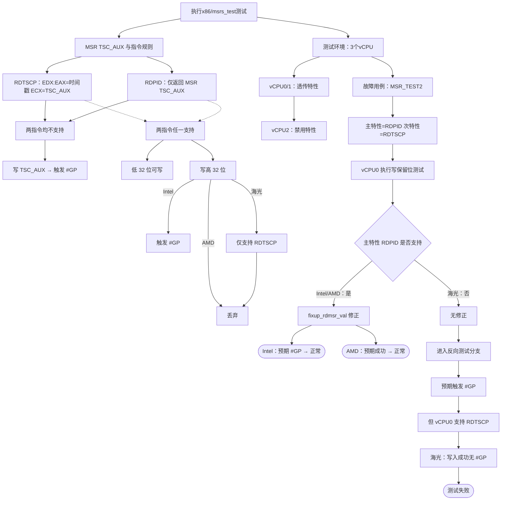

# x86/msrs_test

## 问题描述：执行 x86/msrs_test 测试返回错误。

## 根本原因

* MSR `TSC_AUX` 可以写入一个 `32` bits 的值，比如 LP ID
  * 当执行 `RDTSCP` 指令时，同时读到了某个 LP 的时间戳
    * `EDX:EAX` 返回 `64` bits 的时间戳
    * `ECX` 返回 MSR `TSC_AUX`
  * `RDPID` 指令是简化版，仅返回 MSR `TSC_AUX` 的值
* `RDTSCP` 和 `RDPID` 指令
  * 当 `RDTSCP` 和 `RDPID` **都不支持** 时，写入 MSR `TSC_AUX` 触发 `#GP`
  * 当 `RDTSCP` 和 `RDPID` **任一支持** 时，写入 MSR `TSC_AUX`
    * `31:0` bits 可以任意写入
    * `63:32` bits
      * Intel：保留位，写入会触发 `#GP`；
      * AMD：高 `32` bits 的值会被丢弃，低 `32` bits 写入成功
      * 海光：仅支持 `RDTSCP` 指令，不支持 `RDPID` 指令，写入 MSR `TSC_AUX` 的行为与 AMD 平台保持一致
* 这个测试会创建 3 个 vCPU，其中 vCPU 0、1 透传平台特性，vCPU 2 禁用平台特性
* 问题出在 `MSR_TEST2(MSR_TSC_AUX, 0x12345678, u64_val, RDPID, RDTSCP)`
  * 即 `feature=RDPID`，`feature2=RDTSCP`
  * 具体来说，在 vCPU 0 执行 MSR `TSC_AUX` 的保留位写入测试 `guest_test_reserved_val()`
    * `fixup_rdmsr_val()` 会在支持主特性的时候进行修正，修正结果
      * Intel：进入反向测试分支，即写保留位并期望触发一次 `#GP`
      * AMD：会让其进入写入成功的测试的分支
      * 海光：不支持主特性 `RDPID`， `fixup_rdmsr_val()` 没有机会进行修正
        * 直接进入反向测试分支，即期望对保留位的写入会引发 `#GP`
          * 注意 vCPU0 支持次特性 `RDTSCP`，因此实际上对保留位的写会被忽略，写入成功，没有触发期望的 `#GP`，测试失败

## 修复方案
* v1 版本对于海光平台的写 MSR `TSC_AUX` 保留位检查
  * 只要支持 `RDTSCP` 或 `RDPID` 特性其一即让其 `fixup_rdmsr_val()` 修正，进入写入成功分支，避免进入反向测试分支
* 理论上 AMD 较早的平台也有同样的问题，但没经过验证因此加了较多的限定条件
* Maintainer 觉得这应该是一个共性的问题，因此修改为
  * 主特性和次特性只要有任一支持，则由 `fixup_rdmsr_val()` 修正进一步决定是进行反向测试还是写入成功测试
  * 主特性和次特性均不支持，直接进行反向测试
* 由于 maintainer 直接在 v1 回复中将 patch 发出来了，因此只能将我的 tag 改为 Reported-by
